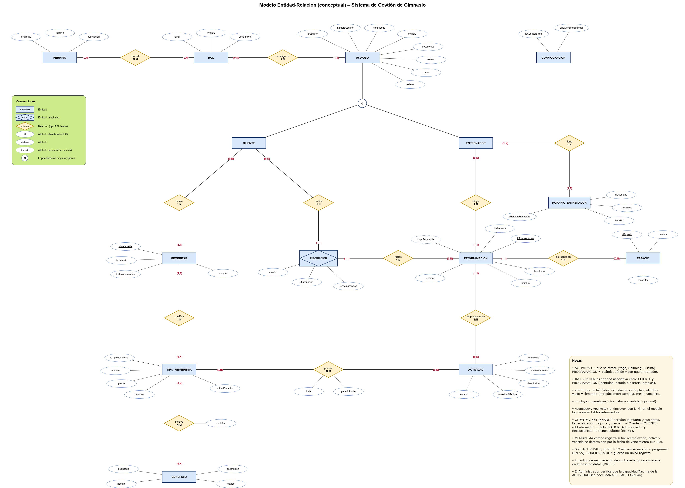
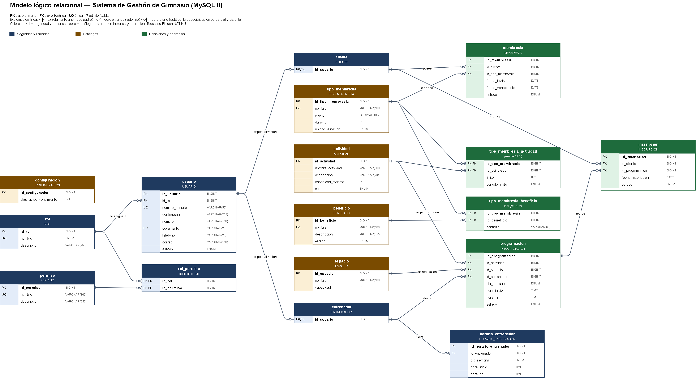

# Fase 4 — Base de datos: modelo conceptual

El modelo conceptual se construyó a partir de las épicas e historias de usuario (01), los requisitos, reglas de negocio y restricciones (02) y el modelo UML (03). El motor de base de datos definido para el proyecto es **MySQL** (RES-03).

## 18. Identificación de entidades

### 18.1. Entidades del modelo

| **Entidad** | **Tipo** | **Qué representa** | **Justificación** | **Fuente** |
| --- | --- | --- | --- | --- |
| USUARIO | Fuerte | Cuenta de acceso y datos personales de cualquier persona que usa el sistema | Todos los roles inician sesión y tienen datos personales; el documento y el nombre de usuario deben ser únicos | RF-25 a RF-28, RF-38, RF-39 · RN-02, RN-30, RN-51 |
| ROL | Fuerte | Perfil de acceso: Administrador, Recepcionista, Entrenador o Cliente | Cada usuario tiene un rol y los permisos dependen del rol | RF-28, RF-37 · RN-31, RN-32, RN-33 · RES-01 |
| PERMISO | Fuerte | Funcionalidad del sistema que puede concederse a un rol | El administrador configura los permisos de cada rol | RF-37 · RN-32, RN-33 · RNF-02 |
| CLIENTE | Especialización de USUARIO | Persona que usa los servicios del gimnasio | Tiene membresías e inscripciones propias | RF-01 a RF-06, RF-15, RF-19 · RN-01 a RN-05 |
| ENTRENADOR | Especialización de USUARIO | Persona que dirige actividades programadas | Tiene horario fijo y actividades asignadas | RF-20 a RF-23, RF-34, RF-35 · RN-22 a RN-25, RN-48 |
| HORARIO_ENTRENADOR | Débil en existencia (depende de ENTRENADOR) | Bloque de horario fijo de un entrenador (día, hora de inicio y fin) | Las programaciones deben quedar dentro del horario fijo del entrenador | RF-34 · RN-24, RN-52 |
| TIPO_MEMBRESIA | Fuerte | Plan que ofrece el gimnasio, parametrizado por el administrador | Define precio, duración, actividades incluidas y beneficios | RF-07, RF-08, RF-30 · RN-06, RN-07, RN-39 |
| BENEFICIO | Fuerte | Servicio informativo que puede incluir un plan (proteína, sauna, etc.) | El administrador gestiona un catálogo propio de beneficios | RF-29, RF-30 · RN-46, RN-47, RN-55 |
| MEMBRESIA | Fuerte | Plan asignado a un cliente, con su vigencia | Se asigna, renueva, reemplaza y consulta por cliente; guarda historial | RF-06, RF-09, RF-10, RF-11 · RN-08 a RN-12, RN-38 |
| ACTIVIDAD | Fuerte | Catálogo de actividades del gimnasio (Yoga, Spinning, Natación…) | Define qué se ofrece y su capacidad máxima; los planes incluyen actividades | RF-31 · RN-13, RN-21, RN-39, RN-55 |
| PROGRAMACION | Fuerte | Realización concreta de una actividad: día, horario, espacio y entrenador | Es lo que el cliente consulta y en lo que se inscribe | RF-12 a RF-14, RF-18, RF-23, RF-33 · RN-13 a RN-16, RN-43 |
| ESPACIO | Fuerte | Lugar del gimnasio donde se realizan las actividades | Evita cruces de programaciones en el mismo lugar | RF-32 · RN-14, RN-44 |
| INSCRIPCION | Asociativa (CLIENTE – PROGRAMACION) | Registro de un cliente en una actividad programada | Resuelve la relación N:M entre clientes y programaciones, con fecha, estado e historial propios | RF-15 a RF-17, RF-19 · RN-17 a RN-21, RN-40 a RN-42 |
| CONFIGURACION | Fuerte (registro único) | Parámetros generales del gimnasio | Guarda los días de aviso de vencimiento que define el administrador | RF-36 · RN-49, RN-54 |

### 18.2. Elementos que no son entidades

| **Elemento** | **Por qué no es una entidad** |
| --- | --- |
| Administrador y Recepcionista | Son usuarios que se distinguen por su ROL; no tienen datos propios adicionales. |
| Dashboard y reportes | Su información se calcula a partir de clientes, membresías y programaciones (RN-27); no se almacena. |
| Cupo disponible | Es un dato derivado: capacidad máxima de la actividad menos inscripciones activas (RN-45). |
| Estado "próxima a vencer" | Es una clasificación calculada con la fecha de vencimiento y los días de aviso (RN-10). |
| Código de recuperación de contraseña | No se almacena en la base de datos; el servidor lo conserva temporalmente (RN-53, RES-12). |
| Sesión de usuario | El inicio y cierre de sesión no requieren persistencia en el modelo. |

## 19. Definición de atributos

Tipos de dato conceptuales: **Entero**, **Decimal**, **Texto**, **Fecha**, **Hora** y **Lista de valores** (texto restringido a valores definidos). Los tipos físicos de MySQL se definen en el modelo lógico.

### 19.1. USUARIO

| **Atributo** | **Descripción** | **Tipo** | **Obligatorio** | **Observación** |
| --- | --- | --- | --- | --- |
| idUsuario | Identificador del usuario | Entero | Sí | Clave primaria |
| nombreUsuario | Nombre para iniciar sesión | Texto | Sí | Único (RN-51) |
| contraseña | Credencial de acceso | Texto | Sí | Se almacena mediante un hash seguro de contraseña, nunca en texto plano ni con cifrado reversible (RNF-01) |
| nombre | Nombre completo | Texto | Sí | RN-01, RN-23 |
| documento | Número de documento | Texto | Sí | Único entre todos los usuarios (RN-02) |
| telefono | Teléfono de contacto | Texto | Sí | También se usa para recuperar la contraseña (RF-27) |
| correo | Correo electrónico | Texto | No | Opcional (RN-01, RN-23); si está registrado, también puede usarse para recuperar la contraseña (RF-27) |
| estado | Estado de la cuenta | Lista de valores | Sí | Activo / Inactivo. Un usuario inactivo no puede iniciar sesión (RN-05, RN-48) |

### 19.2. ROL

| **Atributo** | **Descripción** | **Tipo** | **Obligatorio** | **Observación** |
| --- | --- | --- | --- | --- |
| idRol | Identificador del rol | Entero | Sí | Clave primaria |
| nombre | Nombre del rol | Lista de valores | Sí | Administrador, Recepcionista, Entrenador o Cliente (RN-31). Único |
| descripcion | Descripción del rol | Texto | No | Informativo |

### 19.3. PERMISO

| **Atributo** | **Descripción** | **Tipo** | **Obligatorio** | **Observación** |
| --- | --- | --- | --- | --- |
| idPermiso | Identificador del permiso | Entero | Sí | Clave primaria |
| nombre | Nombre de la funcionalidad que habilita | Texto | Sí | Único |
| descripcion | Descripción del permiso | Texto | No | Informativo |

### 19.4. CLIENTE y ENTRENADOR

Son especializaciones de USUARIO: heredan su identificador y sus atributos. No tienen atributos propios; existen como entidades porque participan en relaciones exclusivas (el cliente posee membresías y realiza inscripciones; el entrenador tiene horario fijo y dirige programaciones).

| **Entidad** | **Atributo** | **Descripción** | **Tipo** | **Obligatorio** | **Observación** |
| --- | --- | --- | --- | --- | --- |
| CLIENTE | idUsuario | Identificador heredado de USUARIO | Entero | Sí | Clave primaria y referencia a USUARIO |
| ENTRENADOR | idUsuario | Identificador heredado de USUARIO | Entero | Sí | Clave primaria y referencia a USUARIO |

### 19.5. HORARIO_ENTRENADOR

| **Atributo** | **Descripción** | **Tipo** | **Obligatorio** | **Observación** |
| --- | --- | --- | --- | --- |
| idHorarioEntrenador | Identificador del bloque de horario | Entero | Sí | Clave primaria |
| diaSemana | Día de la semana | Lista de valores | Sí | Lunes a domingo |
| horaInicio | Hora de inicio | Hora | Sí | — |
| horaFin | Hora de fin | Hora | Sí | Posterior a horaInicio (RN-52) |

### 19.6. TIPO_MEMBRESIA

| **Atributo** | **Descripción** | **Tipo** | **Obligatorio** | **Observación** |
| --- | --- | --- | --- | --- |
| idTipoMembresia | Identificador del tipo de membresía | Entero | Sí | Clave primaria |
| nombre | Nombre del plan | Texto | Sí | Único (RN-07) |
| precio | Precio del plan | Decimal | Sí | Informativo; el sistema no gestiona pagos (RN-06) |
| duracion | Cantidad de tiempo de vigencia | Entero | Sí | Mayor que cero (RN-06) |
| unidadDuracion | Unidad de la duración | Lista de valores | Sí | Días o meses (RN-06) |

### 19.7. BENEFICIO

| **Atributo** | **Descripción** | **Tipo** | **Obligatorio** | **Observación** |
| --- | --- | --- | --- | --- |
| idBeneficio | Identificador del beneficio | Entero | Sí | Clave primaria |
| nombre | Nombre del beneficio | Texto | Sí | Único (RN-47) |
| descripcion | Descripción del beneficio | Texto | No | Informativo |
| estado | Estado del beneficio | Lista de valores | Sí | Activo / Inactivo (RN-55) |

### 19.8. MEMBRESIA

| **Atributo** | **Descripción** | **Tipo** | **Obligatorio** | **Observación** |
| --- | --- | --- | --- | --- |
| idMembresia | Identificador de la membresía | Entero | Sí | Clave primaria |
| fechaInicio | Fecha de inicio de la vigencia | Fecha | Sí | En una renovación, es la fecha actual (RF-11) |
| fechaVencimiento | Fecha de fin de la vigencia | Fecha | Sí | Se calcula al registrar: fechaInicio + duración según su unidad (RN-09) |
| estado | Estado formal de la membresía | Lista de valores | Sí | Registra si la membresía fue reemplazada. Activa y vencida se determinan con la fecha de vencimiento; una membresía reemplazada no vuelve a clasificarse como activa ni vencida (RN-10) |

### 19.9. ACTIVIDAD

| **Atributo** | **Descripción** | **Tipo** | **Obligatorio** | **Observación** |
| --- | --- | --- | --- | --- |
| idActividad | Identificador de la actividad | Entero | Sí | Clave primaria |
| nombreActividad | Nombre de la actividad | Texto | Sí | RN-13 |
| descripcion | Descripción de la actividad | Texto | Sí | CA-31 |
| capacidadMaxima | Cupos por cada programación | Entero | Sí | Mayor que cero. Prevalece para calcular el cupo (RN-45) |
| estado | Estado de la actividad | Lista de valores | Sí | Activa / Inactiva (RN-55) |

### 19.10. PROGRAMACION

| **Atributo** | **Descripción** | **Tipo** | **Obligatorio** | **Observación** |
| --- | --- | --- | --- | --- |
| idProgramacion | Identificador de la programación | Entero | Sí | Clave primaria |
| diaSemana | Día en que se realiza | Lista de valores | Sí | Lunes a domingo |
| horaInicio | Hora de inicio | Hora | Sí | — |
| horaFin | Hora de fin | Hora | Sí | Posterior a horaInicio (RN-52) |
| estado | Estado de la programación | Lista de valores | Sí | Programada / Cancelada (RN-43) |
| cupoDisponible | Cupos libres | Entero | — | **Derivado, no se almacena**: capacidadMaxima de la actividad menos inscripciones activas (RN-45) |

### 19.11. ESPACIO

| **Atributo** | **Descripción** | **Tipo** | **Obligatorio** | **Observación** |
| --- | --- | --- | --- | --- |
| idEspacio | Identificador del espacio | Entero | Sí | Clave primaria |
| nombre | Nombre del espacio | Texto | Sí | — |
| capacidad | Capacidad del espacio | Entero | Sí | Informativa; el administrador verifica que sea adecuada a la actividad (RN-44) |

### 19.12. INSCRIPCION

| **Atributo** | **Descripción** | **Tipo** | **Obligatorio** | **Observación** |
| --- | --- | --- | --- | --- |
| idInscripcion | Identificador de la inscripción | Entero | Sí | Clave primaria |
| fechaInscripcion | Fecha en que se registró | Fecha | Sí | Permite contar inscripciones por período (RN-40) |
| estado | Estado de la inscripción | Lista de valores | Sí | Activa / Cancelada. Las canceladas no cuentan para el límite ni el cupo (RN-20, RN-40) |

### 19.13. CONFIGURACION

| **Atributo** | **Descripción** | **Tipo** | **Obligatorio** | **Observación** |
| --- | --- | --- | --- | --- |
| idConfiguracion | Identificador del registro | Entero | Sí | Clave primaria. Existe un único registro |
| diasAvisoVencimiento | Días de anticipación para clasificar una membresía como próxima a vencer | Entero | Sí | Mínimo 1 (RN-49, RN-54) |

### 19.14. Atributos de las relaciones N:M

| **Relación** | **Atributo** | **Descripción** | **Tipo** | **Obligatorio** | **Observación** |
| --- | --- | --- | --- | --- | --- |
| permite (TIPO_MEMBRESIA – ACTIVIDAD) | limite | Número máximo de inscripciones en el período | Entero | No | Vacío = actividad ilimitada (RN-39) |
| permite (TIPO_MEMBRESIA – ACTIVIDAD) | periodoLimite | Período en que se cuenta el límite | Lista de valores | Solo si hay límite | Semana, mes o vigencia de la membresía (RN-39) |
| incluye (TIPO_MEMBRESIA – BENEFICIO) | cantidad | Cantidad informativa del beneficio | Texto | No | Solo se muestra; el sistema no controla su uso (RN-46) |
| concede (ROL – PERMISO) | — | — | — | — | Sin atributos propios |

## 20. Definición de claves primarias

Todas las entidades usan un identificador artificial como clave primaria, porque los identificadores naturales disponibles pueden editarse (RF-04, RF-21) o son textos. Los datos que deben ser únicos se registran como **claves candidatas**.

| **Entidad** | **Clave primaria** | **Claves candidatas (únicas)** | **Justificación** |
| --- | --- | --- | --- |
| USUARIO | idUsuario | documento (RN-02), nombreUsuario (RN-51) | El documento y el nombre de usuario son únicos, pero editables |
| ROL | idRol | nombre | Los cuatro roles son fijos (RN-31) |
| PERMISO | idPermiso | nombre | — |
| CLIENTE | idUsuario | — | Clave heredada de USUARIO por la especialización |
| ENTRENADOR | idUsuario | — | Clave heredada de USUARIO por la especialización |
| HORARIO_ENTRENADOR | idHorarioEntrenador | — | Un entrenador puede tener varios bloques el mismo día |
| TIPO_MEMBRESIA | idTipoMembresia | nombre (RN-07) | El nombre es editable |
| BENEFICIO | idBeneficio | nombre (RN-47) | El nombre es editable |
| MEMBRESIA | idMembresia | — | Un cliente acumula varias membresías en su historial |
| ACTIVIDAD | idActividad | — | No hay identificador natural |
| PROGRAMACION | idProgramacion | — | Puede haber varias programaciones de la misma actividad |
| ESPACIO | idEspacio | — | No hay identificador natural |
| INSCRIPCION | idInscripcion | — | Un cliente puede volver a inscribirse en la misma programación después de cancelar (RN-42), por lo que la pareja cliente–programación no es única |
| CONFIGURACION | idConfiguracion | — | Registro único |

## 21. Definición de relaciones

La participación se expresa como **(mínimo, máximo)** de cada entidad en la relación.

| **Entidad A** | **Relación** | **Entidad B** | **Cardinalidad** | **Participación** | **Justificación** |
| --- | --- | --- | --- | --- | --- |
| ROL | se asigna a | USUARIO | 1:N | Rol (0,N) · Usuario (1,1) | Cada usuario tiene exactamente un rol (RN-31) |
| ROL | concede | PERMISO | N:M | Rol (0,N) · Permiso (0,N) | Un rol tiene varios permisos y un permiso puede estar en varios roles (RF-37, RN-32) |
| ENTRENADOR | tiene | HORARIO_ENTRENADOR | 1:N | Entrenador (1,N) · Horario (1,1) | Todo entrenador tiene horario fijo (RN-24) |
| CLIENTE | posee | MEMBRESIA | 1:N | Cliente (0,N) · Membresía (1,1) | Historial de membresías; máximo una activa (RN-08, RN-38) |
| TIPO_MEMBRESIA | clasifica | MEMBRESIA | 1:N | Tipo (0,N) · Membresía (1,1) | Toda membresía es de un tipo (RES-07) |
| TIPO_MEMBRESIA | permite | ACTIVIDAD | N:M | Tipo (0,N) · Actividad (0,N) | Actividades incluidas en cada plan, con límite y período (RN-21, RN-39) |
| TIPO_MEMBRESIA | incluye | BENEFICIO | N:M | Tipo (0,N) · Beneficio (0,N) | Beneficios informativos de cada plan (RN-46) |
| ACTIVIDAD | se programa en | PROGRAMACION | 1:N | Actividad (0,N) · Programación (1,1) | Toda programación es de una actividad (RN-13) |
| ESPACIO | se realiza en | PROGRAMACION | 1:N | Espacio (0,N) · Programación (1,1) | Toda programación ocurre en un espacio (RN-13, RN-14) |
| ENTRENADOR | dirige | PROGRAMACION | 1:N | Entrenador (0,N) · Programación (1,1) | Toda programación tiene un entrenador activo (RN-15, RN-16) |
| CLIENTE | realiza | INSCRIPCION | 1:N | Cliente (0,N) · Inscripción (1,1) | Un cliente se inscribe en varias programaciones (RF-15, RF-19) |
| PROGRAMACION | recibe | INSCRIPCION | 1:N | Programación (0,N) · Inscripción (1,1) | Las inscripciones activas no superan la capacidad (RN-18) |

**Especialización de USUARIO.** USUARIO se especializa en CLIENTE y ENTRENADOR de forma **disjunta** (un usuario no puede ser cliente y entrenador a la vez, porque tiene un solo rol, RN-31) y **parcial** (los usuarios con rol Administrador o Recepcionista no se especializan).

**Restricción de correspondencia entre rol y subtipo.** El subtipo de cada usuario depende de su rol (RN-31):

- Un usuario con rol **Cliente** debe tener su registro en CLIENTE, y solo él puede tenerlo.
- Un usuario con rol **Entrenador** debe tener su registro en ENTRENADOR, y solo él puede tenerlo.
- Un usuario con rol **Administrador** o **Recepcionista** no tiene registro en ninguno de los dos subtipos.

Esta regla no se puede expresar solo con la notación de la especialización. Se deberá garantizar en el modelo lógico o en la capa de servicio al crear un usuario y asignarle su rol.

**Relación N:M entre CLIENTE y PROGRAMACION.** Un cliente puede inscribirse en muchas programaciones y una programación recibe muchos clientes. Se resuelve con la entidad asociativa INSCRIPCION porque cada inscripción tiene identidad, fecha y estado propios y debe conservarse en el historial.

**Relaciones N:M sin entidad propia.** «concede», «permite» e «incluye» se representan como relaciones (las dos últimas con atributos). En el modelo lógico se convertirán en tablas intermedias.

## 22. Modelo entidad-relación



Archivo editable: [08_Modelo_Entidad_Relacion.drawio](media/diagrams/08_Diagrama_modelo_ER.drawio)

**Notación:** Chen. Rectángulo = entidad; rectángulo con rombo = entidad asociativa; rombo = relación (con su tipo 1:N o N:M); óvalo = atributo; óvalo con texto subrayado = clave primaria; óvalo punteado = atributo derivado; círculo con "d" = especialización disjunta; la línea simple desde USUARIO indica que es parcial. Los valores (mínimo, máximo) junto a cada entidad indican su participación.

# Base de datos: modelo lógico relacional

## 23. Convenciones y mapeo de tipos de datos

**Nomenclatura física.** Del modelo conceptual (camelCase) al lógico se pasa a **snake_case en minúsculas, sin tildes ni eñes**, con prefijo `id_` en las claves (`idUsuario` → `id_usuario`, `nombreUsuario` → `nombre_usuario`). La conversión es mecánica y 1 a 1, así que se conserva la trazabilidad con la Fase 4. Además:

- Las claves foráneas se nombran por el **rol que cumplen**, no por la tabla de origen: `membresia.id_cliente`, `inscripcion.id_cliente`, `programacion.id_entrenador`, `horario_entrenador.id_entrenador`. Así se entiende qué representa cada FK aunque apunte a `cliente.id_usuario` o `entrenador.id_usuario`.
- Las restricciones llevan nombre explícito: `uq_<tabla>_<columna>`, `chk_<tabla>_<regla>`, `fk_<tabla>_<padre>` e `idx_<tabla>_<columnas>`.

**Motor y configuración.** MySQL **8.0.16 o superior** (RES-03; antes de esa versión los CHECK se aceptan pero no se aplican). Todas las tablas usan `ENGINE=InnoDB` (obligatorio para claves foráneas) y `CHARACTER SET utf8mb4 COLLATE utf8mb4_0900_ai_ci`: admite tildes y «ñ» y compara sin distinguir mayúsculas ni tildes, por lo que `nombre_usuario` es único sin importar cómo se escriba (RN-51). Se recomienda fijar la zona horaria de la sesión en `America/Bogota`, porque las comparaciones de vencimiento usan `CURDATE()`.

| Tipo conceptual (Fase 4) | Tipo MySQL | Uso y justificación |
| --- | --- | --- |
| Entero identificador | `BIGINT AUTO_INCREMENT` | Todas las PK artificiales (sección 20 de la Fase 4). Mapea 1 a 1 con `Long` en JPA/Hibernate; las FK usan exactamente el mismo tipo, requisito de InnoDB. |
| Entero (cantidad o conteo) | `INT` | `capacidad_maxima`, `capacidad`, `duracion`, `limite`, `dias_aviso_vencimiento`; los CHECK impiden valores no positivos. |
| Decimal | `DECIMAL(10,2)` | `precio`: valor monetario exacto, sin error de punto flotante. |
| Texto corto | `VARCHAR(n)` | `nombre`, `documento`, `telefono`, `correo`, `nombre_usuario`, con la longitud ajustada a cada atributo. |
| Contraseña | `VARCHAR(255)` | Guarda el hash (bcrypt o Argon2), nunca el texto plano (RNF-01). |
| Texto descriptivo | `VARCHAR(255)` | `descripcion` de rol, permiso, beneficio y actividad. |
| Fecha / Hora | `DATE` / `TIME` | Fechas de membresía e inscripción sin hora; `hora_inicio` y `hora_fin` sin fecha. |
| Lista de valores | `ENUM(...)` | Dominio cerrado del modelo conceptual. Los valores van **sin tildes** (`'Miercoles'`, `'Sabado'`, `'Dias'`) para evitar problemas de codificación en scripts y en el mapeo a enumeraciones del backend; la interfaz muestra la etiqueta con tilde. |

**Atributos derivados que no se almacenan.** El cupo disponible de una programación y el conteo de inscripciones por período se calculan en consulta o en una vista (sección 30.2). Guardarlos obligaría a sincronizarlos y crearía inconsistencias. El estado de una membresía **sí se almacena** (sección 24.3).

---

## 24. Normalización: 1FN, 2FN y 3FN

Se verificó cada una de las 17 tablas contra las tres primeras formas normales, en ese orden, partiendo de las 14 entidades de la Fase 4 (sección 18.1) y de sus atributos (sección 19). **Resultado: todas cumplen 3FN.** No fue necesario descomponer ninguna entidad adicional, porque la Fase 4 ya había separado los grupos repetitivos; el trabajo de esta fase fue confirmarlo, resolver las relaciones N:M (sección 26) y fijar qué datos derivables se guardan y cuáles no.

### 24.1. Primera forma normal (1FN)

Se cumple en las 17 tablas: cada atributo es atómico (un solo dato por celda), cada tabla tiene una PK que identifica sus filas y no hay grupos repetitivos. Los casos de «varios valores por entidad» ya están en tablas propias: varios horarios de un entrenador en `horario_entrenador`, el historial de membresías de un cliente en `membresia`, sus inscripciones en `inscripcion`, y las actividades y beneficios de cada plan en tablas intermedias (sección 26). El horario se guarda como **un bloque por fila** (día, `hora_inicio`, `hora_fin`) y no como columnas lunes a domingo.

### 24.2. Segunda forma normal (2FN)

Se cumple porque ningún atributo no clave depende solo de una parte de la clave primaria. En las 14 tablas con PK de una sola columna la 2FN es trivial: no existe una «subparte» de la clave. En las 3 tablas con PK compuesta se revisó cada atributo contra las dos mitades de la clave:

- `tipo_membresia_actividad.limite` y `.periodo_limite` dependen del par completo (plan, actividad): el límite es de *ese* plan aplicado a *esa* actividad, no del plan ni de la actividad por separado.
- `tipo_membresia_beneficio.cantidad` depende igualmente del par (plan, beneficio).
- `rol_permiso` no tiene atributos propios, por lo que no hay dependencia parcial posible.

### 24.3. Tercera forma normal (3FN)

Ningún atributo no clave depende de otro atributo no clave. Los puntos donde la 3FN suele fallar, y la decisión tomada en cada uno:

| Atributo | ¿Se puede derivar? | Decisión | Motivo |
| --- | --- | --- | --- |
| `membresia.fecha_vencimiento` | De `fecha_inicio` y la duración del plan (RN-09), pero solo en el momento del registro | **Se almacena** | Es una fotografía histórica: si el plan cambia, las membresías ya emitidas conservan su vencimiento. |
| Estado de la membresía: Activa o Vencida | Sí, de `fecha_vencimiento` y la fecha actual (RN-10, RN-28) | **Se almacena** en `membresia.estado` | RF-10 y RN-10 exigen clasificar las membresías. `estado` es la única fuente de verdad; no existen columnas auxiliares `es_actual` ni `es_activa`. |
| Estado «Próxima a vencer» | Sí: se calcula con `fecha_vencimiento` y `configuracion.dias_aviso_vencimiento` (RN-10, RN-49) | **No se almacena** | Es una clasificación derivada (sección 18.2). Se obtiene en consulta o en la capa de servicio, no como valor del ENUM. |
| Estado Reemplazada | No: depende de que se haya registrado otra membresía (RN-38) | **Se almacena** en el mismo `membresia.estado` | Dominio completo almacenado: `Activa`, `Vencida`, `Cancelada` y `Reemplazada`. |
| Estado Cancelada | No: es una acción explícita del negocio (cancelar una membresía vigente) | **Se almacena** en el mismo `membresia.estado` | Permite distinguir una membresía cancelada de una vencida o reemplazada; no se reclasifica automáticamente por fecha. |
| Cupo disponible | Sí: `capacidad_maxima` menos las inscripciones Activa (RN-45) | **No se almacena** | Cambiaría con cada alta o cancelación; el sobrecupo se evita con bloqueo (sección 30.1). |

**Una sola columna de estado.** `membresia.estado` es la única fuente de verdad del estado de una membresía: **no existen columnas auxiliares ni banderas (`es_actual`, `es_activa`) que lo dupliquen**. El dominio almacenado es `Activa`, `Vencida`, `Cancelada` y `Reemplazada`. La clasificación «Próxima a vencer» se calcula en consulta. La unicidad de la membresía vigente se valida con trigger BEFORE INSERT (sección 29.3) o en la capa de servicio.

### 24.4. Verificación tabla por tabla

Resumen de la verificación de las 17 tablas. «Otras claves únicas» son las claves candidatas además de la PK (sección 20 de la Fase 4); la columna siguiente lista los atributos que dependen de la clave. En todas las tablas el único determinante de esos atributos es la PK o una de esas claves únicas.

| Tabla | Clave primaria | Otras claves únicas | Atributos que dependen de la clave | 1FN | 2FN | 3FN |
| --- | --- | --- | --- | --- | --- | --- |
| `rol` | `id_rol` | `nombre` | `descripcion` | ✓ | ✓ | ✓ |
| `permiso` | `id_permiso` | `nombre` | `descripcion` | ✓ | ✓ | ✓ |
| `rol_permiso` | (`id_rol`, `id_permiso`) | — | ninguno | ✓ | ✓ | ✓ |
| `usuario` | `id_usuario` | `documento`, `nombre_usuario` | `id_rol`, `contrasena`, `nombre`, `telefono`, `correo`, `estado` | ✓ | ✓ | ✓ |
| `cliente` | `id_usuario` | — | ninguno | ✓ | ✓ | ✓ |
| `entrenador` | `id_usuario` | — | ninguno | ✓ | ✓ | ✓ |
| `horario_entrenador` | `id_horario_entrenador` | — | `id_entrenador`, `dia_semana`, `hora_inicio`, `hora_fin` | ✓ | ✓ | ✓ |
| `tipo_membresia` | `id_tipo_membresia` | `nombre` | `precio`, `duracion`, `unidad_duracion` | ✓ | ✓ | ✓ |
| `beneficio` | `id_beneficio` | `nombre` | `descripcion`, `estado` | ✓ | ✓ | ✓ |
| `actividad` | `id_actividad` | — | `nombre_actividad`, `descripcion`, `capacidad_maxima`, `estado` | ✓ | ✓ | ✓ |
| `espacio` | `id_espacio` | — | `nombre`, `capacidad` | ✓ | ✓ | ✓ |
| `configuracion` | `id_configuracion` | — | `dias_aviso_vencimiento` | ✓ | ✓ | ✓ |
| `tipo_membresia_actividad` | (`id_tipo_membresia`, `id_actividad`) | — | `limite`, `periodo_limite` | ✓ | ✓ | ✓ |
| `tipo_membresia_beneficio` | (`id_tipo_membresia`, `id_beneficio`) | — | `cantidad` | ✓ | ✓ | ✓ |
| `membresia` | `id_membresia` | — | `id_cliente`, `id_tipo_membresia`, `fecha_inicio`, `fecha_vencimiento`, `estado` | ✓ | ✓ | ✓ |
| `programacion` | `id_programacion` | — | `id_actividad`, `id_espacio`, `id_entrenador`, `dia_semana`, `hora_inicio`, `hora_fin`, `estado` | ✓ | ✓ | ✓ |
| `inscripcion` | `id_inscripcion` | — | `id_cliente`, `id_programacion`, `fecha_inscripcion`, `estado` | ✓ | ✓ | ✓ |

Como todo determinante es una clave, el modelo tampoco viola la forma normal de Boyce-Codd, así que no hace falta ir más allá de la 3FN. Ninguna tabla tiene columnas auxiliares: cada columna es un dato del negocio o una clave.

---

## 25. Mapeo de la especialización USUARIO → CLIENTE / ENTRENADOR

**Estrategia elegida: una tabla por subtipo, cuya PK es a la vez FK al supertipo** («class table inheritance»). Es la que ya insinúa la Fase 4 (sección 19.4), donde CLIENTE y ENTRENADOR solo declaran `idUsuario` como clave primaria y referencia a USUARIO.

```
usuario     (id_usuario PK, id_rol FK, nombre_usuario, contrasena, nombre, documento, telefono, correo, estado)
cliente     (id_usuario PK, FK → usuario.id_usuario)
entrenador  (id_usuario PK, FK → usuario.id_usuario)
```

| Alternativa | Por qué se descarta o se elige |
| --- | --- |
| Una sola tabla `usuario` con todos los atributos | No aplica: ni CLIENTE ni ENTRENADOR tienen atributos propios, así que no hay columnas que fusionar. Además se perdería la tabla precisa a la que apuntan las FK de `membresia` e `inscripcion` (cliente) y de `programacion` y `horario_entrenador` (entrenador), que es lo que impide asignar una membresía a un administrador o poner a un cliente a dirigir una clase. |
| Una tabla por subtipo **sin** tabla `usuario` | Rompería la unicidad de `documento` y `nombre_usuario` entre todos los usuarios (RN-02, RN-51) y Administrador y Recepcionista quedarían sin tabla donde existir. |
| **Subtipo con PK = FK (la elegida)** | `usuario` sigue siendo el único punto de unicidad e inicio de sesión, sin columnas nulas por subtipo, y las FK de las demás tablas apuntan con precisión a `cliente` o a `entrenador`. |

**Disyunción y parcialidad** (la restricción de la Fase 4 «disjunta y parcial»):

- *Disjunta:* un `id_usuario` puede estar en `cliente` **o** en `entrenador`, nunca en ambas.
- *Parcial:* puede no estar en ninguna; es el caso de Administrador y Recepcionista.

**Correspondencia rol ↔ subtipo (RN-31).** PK y FK por sí solas no impiden insertar en `cliente` a un usuario con rol Entrenador, ni que un usuario con rol Cliente se quede sin su fila en `cliente`. La Fase 4 dejó esa garantía «en el modelo lógico o en la capa de servicio» (sección 21); aquí se resuelve en el motor con cuatro triggers, probados en MySQL 8:

| Trigger | Evento | Qué hace |
| --- | --- | --- |
| `trg_cliente_bi` | BEFORE INSERT en `cliente` | Rechaza la fila (SQLSTATE 45000) si el usuario no tiene rol Cliente. |
| `trg_entrenador_bi` | BEFORE INSERT en `entrenador` | Rechaza la fila si el usuario no tiene rol Entrenador. |
| `trg_usuario_ai` | AFTER INSERT en `usuario` | Crea la fila del subtipo según el rol: Cliente → `cliente`, Entrenador → `entrenador`; Administrador y Recepcionista no tienen subtipo. |
| `trg_usuario_au` | AFTER UPDATE en `usuario` | Si cambia `id_rol`, elimina la fila del subtipo anterior y crea la del nuevo. Si el subtipo anterior ya tiene membresías, inscripciones o programaciones, el DELETE falla por las FK RESTRICT y **todo el cambio de rol se revierte**; los bloques de `horario_entrenador` no lo impiden, porque se eliminan en cascada junto con el subtipo. |

Así el servicio solo inserta en `usuario` y el subtipo aparece solo; el cambio de rol de un usuario con historial queda bloqueado por la propia base de datos. El código completo de los cuatro triggers está en `triggers.sql` (referencia validada, sección 33.4).

---

## 26. Descomposición de las relaciones N:M en tablas intermedias

Las relaciones N:M del modelo conceptual se convierten en tablas intermedias. En las tres relaciones puras, la clave primaria es **compuesta** por las dos claves foráneas que hereda de las entidades que relaciona; es el estándar para resolver N:M y garantiza que el mismo par no se repita. La cuarta, INSCRIPCION, sigue otro patrón por una razón que se explica más abajo.

| Relación conceptual | Tabla resultante | Atributos propios | Clave primaria | Claves foráneas |
| --- | --- | --- | --- | --- |
| ROL **concede** PERMISO | `rol_permiso` | — (relación pura) | (`id_rol`, `id_permiso`) | `id_rol` → `rol` · `id_permiso` → `permiso` |
| TIPO_MEMBRESIA **permite** ACTIVIDAD | `tipo_membresia_actividad` | `limite`, `periodo_limite` | (`id_tipo_membresia`, `id_actividad`) | `id_tipo_membresia` → `tipo_membresia` · `id_actividad` → `actividad` |
| TIPO_MEMBRESIA **incluye** BENEFICIO | `tipo_membresia_beneficio` | `cantidad` | (`id_tipo_membresia`, `id_beneficio`) | `id_tipo_membresia` → `tipo_membresia` · `id_beneficio` → `beneficio` |
| CLIENTE — PROGRAMACION, mediante INSCRIPCION | `inscripcion` | `fecha_inscripcion`, `estado` | `id_inscripcion` (simple, artificial) | `id_cliente` → `cliente` · `id_programacion` → `programacion` |

**Por qué INSCRIPCION no usa clave compuesta.** En las otras tres el par (A, B) es irrepetible. INSCRIPCION ya nació en la Fase 4 como **entidad asociativa con identidad propia** (sección 18.1) porque un mismo cliente puede volver a inscribirse en la misma programación después de cancelar (RN-42): el par (`id_cliente`, `id_programacion`) **sí puede repetirse**, en filas con estados distintos. Por eso lleva PK simple `id_inscripcion`.

Lo que sí se prohíbe es tener dos inscripciones **activas** del mismo cliente en la misma programación. Se garantiza con el trigger `trg_inscripcion_bi` (BEFORE INSERT), que rechaza una inscripción Activa si ya existe otra Activa del mismo cliente en esa programación; las canceladas no cuentan, así que conviven muchas canceladas y una sola activa (sección 29.3).

**Atributos propios de las relaciones** (confirmados contra la sección 19.14 de la Fase 4):

- `limite` es **NULL cuando el plan no limita** esa actividad (RN-39). Si tiene valor, `periodo_limite` (`Semana`, `Mes` o `Vigencia`) es obligatorio, y viceversa; lo refuerzan dos CHECK.
- `cantidad` es solo informativa (RN-46): el sistema no controla su consumo, así que es texto libre y no un contador que se descuente.

**Borrado.** Las tres tablas intermedias usan `ON DELETE CASCADE`: sus filas no tienen sentido sin alguno de sus dos padres. En la práctica los catálogos con `estado` se desactivan en lugar de eliminarse (RN-55), y un plan con membresías emitidas no se puede borrar porque `membresia` lo referencia con RESTRICT.

---

## 27. Diagrama del modelo lógico relacional


diagrama editable: [09_Diagrama_modelo_logico.drawio](media/diagrams/09_Diagrama_modelo_logico.drawio)

**Notación:** cada recuadro es una tabla; su nombre aparece en negrita y, debajo, la entidad o relación de la Fase 4 de la que proviene. En cada columna, **PK** = clave primaria (en negrita) · **FK** = clave foránea · **UQ** = única · **?** = admite NULL. Las notas amarillas bajo `membresia` e `inscripcion` indican los valores de estado y la regla de unicidad que valida un trigger (sección 29.3). Colores: azul = seguridad y usuarios · ocre = catálogos · verde = relaciones y operación. Extremos de las líneas: `┤├` = exactamente uno (lado padre) · `○<` = cero o varios (lado hijo); en las especializaciones, el extremo del subtipo se dibuja `○┤` = cero o uno, porque la especialización es parcial y disjunta (sección 25). Todas las FK son NOT NULL, así que cada fila hija pertenece siempre a un padre. `configuracion` no tiene relaciones: es una tabla de un solo registro.

---

## 28. Esquema de tablas (modelo lógico completo)

Convenciones de esta sección: **PK** = clave primaria · **FK** = clave foránea, con su tabla de origen · **UQ** = clave única. Los tipos siguen la sección 23. La columna «Nulo» indica si la columna admite NULL; todas las claves foráneas son NOT NULL. Bajo cada tabla se listan sus restricciones (UNIQUE compuestos, CHECK, índices y FK con su acción referencial); la vista consolidada está en la sección 29.

### 28.1. Seguridad y usuarios

**`rol`** — ROL

| Columna | Tipo MySQL | Nulo | Clave | Observación |
| --- | --- | --- | --- | --- |
| id_rol | BIGINT AUTO_INCREMENT | NOT NULL | PK | — |
| nombre | ENUM('Administrador','Recepcionista','Entrenador','Cliente') | NOT NULL | UQ | Único; los 4 roles son fijos (RN-31) |
| descripcion | VARCHAR(255) | NULL | — | Informativo |

**`permiso`** — PERMISO

| Columna | Tipo MySQL | Nulo | Clave | Observación |
| --- | --- | --- | --- | --- |
| id_permiso | BIGINT AUTO_INCREMENT | NOT NULL | PK | — |
| nombre | VARCHAR(100) | NOT NULL | UQ | Único; funcionalidad que habilita |
| descripcion | VARCHAR(255) | NULL | — | Informativo |

**`rol_permiso`** — concede (N:M)

| Columna | Tipo MySQL | Nulo | Clave | Observación |
| --- | --- | --- | --- | --- |
| id_rol | BIGINT | NOT NULL | PK (1/2) · FK → rol.id_rol | — |
| id_permiso | BIGINT | NOT NULL | PK (2/2) · FK → permiso.id_permiso | — |

Restricciones: FK `fk_rol_permiso_rol` ON DELETE CASCADE ON UPDATE CASCADE · FK `fk_rol_permiso_permiso` ON DELETE CASCADE ON UPDATE CASCADE

**`usuario`** — USUARIO

| Columna | Tipo MySQL | Nulo | Clave | Observación |
| --- | --- | --- | --- | --- |
| id_usuario | BIGINT AUTO_INCREMENT | NOT NULL | PK | — |
| id_rol | BIGINT | NOT NULL | FK → rol.id_rol | Cada usuario tiene exactamente un rol (RN-31) |
| nombre_usuario | VARCHAR(50) | NULL | UQ | Único (RN-51). NULL hasta crear las credenciales (RF-38) |
| contrasena | VARCHAR(255) | NULL | — | Hash seguro, nunca texto plano (RNF-01). NULL hasta crear las credenciales |
| nombre | VARCHAR(150) | NOT NULL | — | RN-01, RN-23 |
| documento | VARCHAR(20) | NOT NULL | UQ | Único entre todos los usuarios (RN-02) |
| telefono | VARCHAR(20) | NOT NULL | — | También sirve para recuperar la contraseña (RF-27) |
| correo | VARCHAR(150) | NULL | — | Opcional (RN-01, RN-23) |
| estado | ENUM('Activo','Inactivo') DEFAULT 'Activo' | NOT NULL | — | Un usuario inactivo no inicia sesión (RN-05, RN-48) |

Restricciones: CHECK `chk_usuario_credenciales`: `(nombre_usuario IS NULL) = (contrasena IS NULL)` · INDEX `idx_usuario_nombre` (nombre) · FK `fk_usuario_rol` ON DELETE RESTRICT ON UPDATE CASCADE

**`cliente`** — CLIENTE

| Columna | Tipo MySQL | Nulo | Clave | Observación |
| --- | --- | --- | --- | --- |
| id_usuario | BIGINT | NOT NULL | PK · FK → usuario.id_usuario | Subtipo de usuario con rol Cliente |

Restricciones: FK `fk_cliente_usuario` ON DELETE CASCADE ON UPDATE CASCADE

**`entrenador`** — ENTRENADOR

| Columna | Tipo MySQL | Nulo | Clave | Observación |
| --- | --- | --- | --- | --- |
| id_usuario | BIGINT | NOT NULL | PK · FK → usuario.id_usuario | Subtipo de usuario con rol Entrenador |

Restricciones: FK `fk_entrenador_usuario` ON DELETE CASCADE ON UPDATE CASCADE

**`horario_entrenador`** — HORARIO_ENTRENADOR

| Columna | Tipo MySQL | Nulo | Clave | Observación |
| --- | --- | --- | --- | --- |
| id_horario_entrenador | BIGINT AUTO_INCREMENT | NOT NULL | PK | — |
| id_entrenador | BIGINT | NOT NULL | FK → entrenador.id_usuario | Entrenador al que pertenece el bloque |
| dia_semana | ENUM('Lunes','Martes','Miercoles','Jueves','Viernes','Sabado','Domingo') | NOT NULL | — | — |
| hora_inicio | TIME | NOT NULL | — | — |
| hora_fin | TIME | NOT NULL | — | Posterior a hora_inicio (RN-52) |

Restricciones: CHECK `chk_horario_horas`: `hora_fin > hora_inicio` · INDEX `idx_horario_entrenador_dia` (id_entrenador, dia_semana) · FK `fk_horario_entrenador_entrenador` ON DELETE CASCADE ON UPDATE CASCADE

### 28.2. Catálogos

**`tipo_membresia`** — TIPO_MEMBRESIA

| Columna | Tipo MySQL | Nulo | Clave | Observación |
| --- | --- | --- | --- | --- |
| id_tipo_membresia | BIGINT AUTO_INCREMENT | NOT NULL | PK | — |
| nombre | VARCHAR(100) | NOT NULL | UQ | Único (RN-07) |
| precio | DECIMAL(10,2) | NOT NULL | — | Informativo; el sistema no gestiona pagos (RN-06). Mínimo 0 |
| duracion | INT | NOT NULL | — | Mayor que cero (RN-06) |
| unidad_duracion | ENUM('Dias','Meses') | NOT NULL | — | RN-06 |

Restricciones: CHECK `chk_tipo_membresia_precio`: `precio >= 0` · CHECK `chk_tipo_membresia_duracion`: `duracion > 0`

**`beneficio`** — BENEFICIO

| Columna | Tipo MySQL | Nulo | Clave | Observación |
| --- | --- | --- | --- | --- |
| id_beneficio | BIGINT AUTO_INCREMENT | NOT NULL | PK | — |
| nombre | VARCHAR(100) | NOT NULL | UQ | Único (RN-47) |
| descripcion | VARCHAR(255) | NULL | — | Informativo |
| estado | ENUM('Activo','Inactivo') DEFAULT 'Activo' | NOT NULL | — | Solo los activos se asocian a planes (RN-55) |

**`actividad`** — ACTIVIDAD

| Columna | Tipo MySQL | Nulo | Clave | Observación |
| --- | --- | --- | --- | --- |
| id_actividad | BIGINT AUTO_INCREMENT | NOT NULL | PK | — |
| nombre_actividad | VARCHAR(100) | NOT NULL | — | RN-13 |
| descripcion | VARCHAR(255) | NOT NULL | — | Obligatoria (CA-31) |
| capacidad_maxima | INT | NOT NULL | — | Cupos por programación; mayor que cero (RN-45) |
| estado | ENUM('Activa','Inactiva') DEFAULT 'Activa' | NOT NULL | — | Solo las activas se asocian o programan (RN-55) |

Restricciones: CHECK `chk_actividad_capacidad`: `capacidad_maxima > 0`

**`espacio`** — ESPACIO

| Columna | Tipo MySQL | Nulo | Clave | Observación |
| --- | --- | --- | --- | --- |
| id_espacio | BIGINT AUTO_INCREMENT | NOT NULL | PK | — |
| nombre | VARCHAR(100) | NOT NULL | — | — |
| capacidad | INT | NOT NULL | — | Informativa (RN-44); mayor que cero |

Restricciones: CHECK `chk_espacio_capacidad`: `capacidad > 0`

**`configuracion`** — CONFIGURACION

| Columna | Tipo MySQL | Nulo | Clave | Observación |
| --- | --- | --- | --- | --- |
| id_configuracion | BIGINT | NOT NULL | PK | Siempre 1: registro único |
| dias_aviso_vencimiento | INT | NOT NULL | — | Entero >= 1 (RN-49, RN-54) |

Restricciones: CHECK `chk_configuracion_unica`: `id_configuracion = 1` · CHECK `chk_configuracion_dias`: `dias_aviso_vencimiento >= 1`

`tipo_membresia` **no tiene columna `estado`**, igual que en la sección 19.6 de la Fase 4. Un plan con membresías emitidas no se puede borrar (FK RESTRICT), así que su historial se conserva (RN-38). Esta decisión se explica en la sección 32.

### 28.3. Relaciones y operación

**`tipo_membresia_actividad`** — permite (N:M)

| Columna | Tipo MySQL | Nulo | Clave | Observación |
| --- | --- | --- | --- | --- |
| id_tipo_membresia | BIGINT | NOT NULL | PK (1/2) · FK → tipo_membresia.id_tipo_membresia | — |
| id_actividad | BIGINT | NOT NULL | PK (2/2) · FK → actividad.id_actividad | — |
| limite | INT | NULL | — | NULL = ilimitada (RN-39); si existe, mayor que cero |
| periodo_limite | ENUM('Semana','Mes','Vigencia') | NULL | — | Obligatorio si hay límite; NULL si no (RN-39) |

Restricciones: CHECK `chk_tma_limite_periodo`: `(limite IS NULL AND periodo_limite IS NULL) OR (limite IS NOT NULL AND periodo_limite IS NOT NULL)` · CHECK `chk_tma_limite_positivo`: `limite IS NULL OR limite > 0` · FK `fk_tma_tipo_membresia` ON DELETE CASCADE ON UPDATE CASCADE · FK `fk_tma_actividad` ON DELETE CASCADE ON UPDATE CASCADE

**`tipo_membresia_beneficio`** — incluye (N:M)

| Columna | Tipo MySQL | Nulo | Clave | Observación |
| --- | --- | --- | --- | --- |
| id_tipo_membresia | BIGINT | NOT NULL | PK (1/2) · FK → tipo_membresia.id_tipo_membresia | — |
| id_beneficio | BIGINT | NOT NULL | PK (2/2) · FK → beneficio.id_beneficio | — |
| cantidad | VARCHAR(50) | NULL | — | Informativa; el sistema no controla su uso (RN-46) |

Restricciones: FK `fk_tmb_tipo_membresia` ON DELETE CASCADE ON UPDATE CASCADE · FK `fk_tmb_beneficio` ON DELETE CASCADE ON UPDATE CASCADE

**`membresia`** — MEMBRESIA

| Columna | Tipo MySQL | Nulo | Clave | Observación |
| --- | --- | --- | --- | --- |
| id_membresia | BIGINT AUTO_INCREMENT | NOT NULL | PK | — |
| id_cliente | BIGINT | NOT NULL | FK → cliente.id_usuario | Cliente dueño de la membresía (RN-08) |
| id_tipo_membresia | BIGINT | NOT NULL | FK → tipo_membresia.id_tipo_membresia | Plan contratado (RES-07) |
| fecha_inicio | DATE | NOT NULL | — | En una renovación es la fecha actual (RF-11) |
| fecha_vencimiento | DATE | NOT NULL | — | fecha_inicio + duración según su unidad (RN-09); posterior a fecha_inicio |
| estado | ENUM('Activa','Vencida','Cancelada','Reemplazada') DEFAULT 'Activa' | NOT NULL | — | Estados de negocio (RF-10, RN-10, RN-38). Activa y Vencida los actualiza el servicio por fecha (sección 30.3). Cancelada y Reemplazada son estados finales. «Próxima a vencer» es clasificación derivada, no se almacena. |

Restricciones: CHECK `chk_membresia_fechas`: `fecha_vencimiento > fecha_inicio` · INDEX `idx_membresia_estado_vencimiento` (estado, fecha_vencimiento) · FK `fk_membresia_cliente` ON DELETE RESTRICT ON UPDATE CASCADE · FK `fk_membresia_tipo_membresia` ON DELETE RESTRICT ON UPDATE CASCADE

**`programacion`** — PROGRAMACION

| Columna | Tipo MySQL | Nulo | Clave | Observación |
| --- | --- | --- | --- | --- |
| id_programacion | BIGINT AUTO_INCREMENT | NOT NULL | PK | — |
| id_actividad | BIGINT | NOT NULL | FK → actividad.id_actividad | Actividad que se realiza (RN-13) |
| id_espacio | BIGINT | NOT NULL | FK → espacio.id_espacio | Espacio donde ocurre (RN-13) |
| id_entrenador | BIGINT | NOT NULL | FK → entrenador.id_usuario | Entrenador que la dirige (RN-15) |
| dia_semana | ENUM('Lunes','Martes','Miercoles','Jueves','Viernes','Sabado','Domingo') | NOT NULL | — | — |
| hora_inicio | TIME | NOT NULL | — | — |
| hora_fin | TIME | NOT NULL | — | Posterior a hora_inicio (RN-52) |
| estado | ENUM('Programada','Cancelada') DEFAULT 'Programada' | NOT NULL | — | RN-43 |

Restricciones: CHECK `chk_programacion_horas`: `hora_fin > hora_inicio` · INDEX `idx_programacion_espacio_dia` (id_espacio, dia_semana, hora_inicio) · INDEX `idx_programacion_entrenador_dia` (id_entrenador, dia_semana, hora_inicio) · FK `fk_programacion_actividad` ON DELETE RESTRICT ON UPDATE CASCADE · FK `fk_programacion_espacio` ON DELETE RESTRICT ON UPDATE CASCADE · FK `fk_programacion_entrenador` ON DELETE RESTRICT ON UPDATE CASCADE

**`inscripcion`** — INSCRIPCION

| Columna | Tipo MySQL | Nulo | Clave | Observación |
| --- | --- | --- | --- | --- |
| id_inscripcion | BIGINT AUTO_INCREMENT | NOT NULL | PK | — |
| id_cliente | BIGINT | NOT NULL | FK → cliente.id_usuario | Cliente inscrito |
| id_programacion | BIGINT | NOT NULL | FK → programacion.id_programacion | Programación elegida |
| fecha_inscripcion | DATE | NOT NULL | — | Permite contar inscripciones por período (RN-40) |
| estado | ENUM('Activa','Cancelada') DEFAULT 'Activa' | NOT NULL | — | Las canceladas no cuentan para cupo ni límite (RN-20, RN-40). Una sola Activa por cliente y programación (RN-42, sección 29.3) |

Restricciones: INDEX `idx_inscripcion_programacion_estado` (id_programacion, estado) · INDEX `idx_inscripcion_cliente_estado_fecha` (id_cliente, estado, fecha_inscripcion) · FK `fk_inscripcion_cliente` ON DELETE RESTRICT ON UPDATE CASCADE · FK `fk_inscripcion_programacion` ON DELETE RESTRICT ON UPDATE CASCADE

**Cupo disponible.** `cupo_disponible` de la Fase 4 (sección 19.10) **no es una columna de `programacion`**: es `actividad.capacidad_maxima` menos el número de `inscripcion` con estado Activa de esa programación (consulta en la sección 30.2).

---

## 29. Matriz global de claves, restricciones e índices

Vista consolidada de todo lo que la Persona 3 debe declarar en el DDL, ordenada por tipo de restricción. Es la misma información de la sección 28, reagrupada para revisarla de una vez.

### 29.1. Claves foráneas (17)

| N.º | Tabla hija | Columna FK | Tabla padre | Columna referenciada | Cardinalidad | ON DELETE | ON UPDATE | Nombre de la FK |
| --- | --- | --- | --- | --- | --- | --- | --- | --- |
| 1 | rol_permiso | id_rol | rol | id_rol | N:1 | CASCADE | CASCADE | fk_rol_permiso_rol |
| 2 | rol_permiso | id_permiso | permiso | id_permiso | N:1 | CASCADE | CASCADE | fk_rol_permiso_permiso |
| 3 | usuario | id_rol | rol | id_rol | N:1 | RESTRICT | CASCADE | fk_usuario_rol |
| 4 | cliente | id_usuario | usuario | id_usuario | 1:1 (subtipo) | CASCADE | CASCADE | fk_cliente_usuario |
| 5 | entrenador | id_usuario | usuario | id_usuario | 1:1 (subtipo) | CASCADE | CASCADE | fk_entrenador_usuario |
| 6 | horario_entrenador | id_entrenador | entrenador | id_usuario | N:1 | CASCADE | CASCADE | fk_horario_entrenador_entrenador |
| 7 | tipo_membresia_actividad | id_tipo_membresia | tipo_membresia | id_tipo_membresia | N:1 | CASCADE | CASCADE | fk_tma_tipo_membresia |
| 8 | tipo_membresia_actividad | id_actividad | actividad | id_actividad | N:1 | CASCADE | CASCADE | fk_tma_actividad |
| 9 | tipo_membresia_beneficio | id_tipo_membresia | tipo_membresia | id_tipo_membresia | N:1 | CASCADE | CASCADE | fk_tmb_tipo_membresia |
| 10 | tipo_membresia_beneficio | id_beneficio | beneficio | id_beneficio | N:1 | CASCADE | CASCADE | fk_tmb_beneficio |
| 11 | membresia | id_cliente | cliente | id_usuario | N:1 | RESTRICT | CASCADE | fk_membresia_cliente |
| 12 | membresia | id_tipo_membresia | tipo_membresia | id_tipo_membresia | N:1 | RESTRICT | CASCADE | fk_membresia_tipo_membresia |
| 13 | programacion | id_actividad | actividad | id_actividad | N:1 | RESTRICT | CASCADE | fk_programacion_actividad |
| 14 | programacion | id_espacio | espacio | id_espacio | N:1 | RESTRICT | CASCADE | fk_programacion_espacio |
| 15 | programacion | id_entrenador | entrenador | id_usuario | N:1 | RESTRICT | CASCADE | fk_programacion_entrenador |
| 16 | inscripcion | id_cliente | cliente | id_usuario | N:1 | RESTRICT | CASCADE | fk_inscripcion_cliente |
| 17 | inscripcion | id_programacion | programacion | id_programacion | N:1 | RESTRICT | CASCADE | fk_inscripcion_programacion |

**Criterio de las acciones referenciales.** `ON DELETE CASCADE` se usa donde la fila hija no tiene sentido sin su padre: los subtipos `cliente` y `entrenador`, las tres tablas intermedias y `horario_entrenador`. `ON DELETE RESTRICT` protege lo histórico y transaccional (`membresia`, `programacion`, `inscripcion`) y el rol de cada usuario: no se puede borrar un cliente con membresías, un plan emitido, una actividad programada ni una programación con inscripciones. Es coherente con la Fase 4, donde usuarios, actividades y beneficios se desactivan mediante `estado`. `ON UPDATE CASCADE` se mantiene uniforme; ninguna PK cambia en operación normal.

**Tablas raíz** (sin FK saliente): `rol`, `permiso`, `tipo_membresia`, `beneficio`, `actividad`, `espacio` y `configuracion`.

### 29.2. Claves primarias (17)

| Tabla | Clave primaria | Tipo de clave |
| --- | --- | --- |
| rol | id_rol | Simple, autoincremental |
| permiso | id_permiso | Simple, autoincremental |
| rol_permiso | id_rol, id_permiso | Compuesta, formada por dos FK |
| usuario | id_usuario | Simple, autoincremental |
| cliente | id_usuario | Simple, a la vez FK al supertipo |
| entrenador | id_usuario | Simple, a la vez FK al supertipo |
| horario_entrenador | id_horario_entrenador | Simple, autoincremental |
| tipo_membresia | id_tipo_membresia | Simple, autoincremental |
| beneficio | id_beneficio | Simple, autoincremental |
| actividad | id_actividad | Simple, autoincremental |
| espacio | id_espacio | Simple, autoincremental |
| configuracion | id_configuracion | Fija (siempre 1) |
| tipo_membresia_actividad | id_tipo_membresia, id_actividad | Compuesta, formada por dos FK |
| tipo_membresia_beneficio | id_tipo_membresia, id_beneficio | Compuesta, formada por dos FK |
| membresia | id_membresia | Simple, autoincremental |
| programacion | id_programacion | Simple, autoincremental |
| inscripcion | id_inscripcion | Simple, autoincremental |

### 29.3. UNIQUE y CHECK (6 + 12) y unicidad condicional

| Tabla | Restricción | Definición | Regla que garantiza |
| --- | --- | --- | --- |
| rol | UNIQUE `uq_rol_nombre` | (nombre) | Los 4 roles son fijos y no se repiten (RN-31) |
| permiso | UNIQUE `uq_permiso_nombre` | (nombre) | Un solo permiso por funcionalidad |
| usuario | UNIQUE `uq_usuario_nombre_usuario` | (nombre_usuario) | Nombre de usuario único (RN-51); admite varios NULL (clientes sin credenciales) |
| usuario | UNIQUE `uq_usuario_documento` | (documento) | Documento único entre todos los usuarios (RN-02) |
| usuario | CHECK `chk_usuario_credenciales` | `(nombre_usuario IS NULL) = (contrasena IS NULL)` | Usuario y contraseña van juntos o ninguno de los dos (RF-01, RF-38) |
| horario_entrenador | CHECK `chk_horario_horas` | `hora_fin > hora_inicio` | El bloque termina después de empezar (RN-52) |
| tipo_membresia | UNIQUE `uq_tipo_membresia_nombre` | (nombre) | Nombre de plan único (RN-07) |
| tipo_membresia | CHECK `chk_tipo_membresia_precio` | `precio >= 0` | Precio no negativo; es informativo (RN-06) |
| tipo_membresia | CHECK `chk_tipo_membresia_duracion` | `duracion > 0` | Duración positiva (RN-06) |
| beneficio | UNIQUE `uq_beneficio_nombre` | (nombre) | Nombre de beneficio único (RN-47) |
| actividad | CHECK `chk_actividad_capacidad` | `capacidad_maxima > 0` | Capacidad máxima positiva (RN-45) |
| espacio | CHECK `chk_espacio_capacidad` | `capacidad > 0` | Capacidad positiva (RN-44) |
| configuracion | CHECK `chk_configuracion_unica` | `id_configuracion = 1` | Un único registro de configuración |
| configuracion | CHECK `chk_configuracion_dias` | `dias_aviso_vencimiento >= 1` | Días de aviso de al menos 1 (RN-49) |
| tipo_membresia_actividad | CHECK `chk_tma_limite_periodo` | `(limite IS NULL AND periodo_limite IS NULL) OR (limite IS NOT NULL AND periodo_limite IS NOT NULL)` | Límite y período van juntos o ninguno de los dos (RN-39) |
| tipo_membresia_actividad | CHECK `chk_tma_limite_positivo` | `limite IS NULL OR limite > 0` | Si hay límite, es mayor que cero (RN-39) |
| membresia | CHECK `chk_membresia_fechas` | `fecha_vencimiento > fecha_inicio` | El vencimiento es posterior al inicio (RN-09) |
| programacion | CHECK `chk_programacion_horas` | `hora_fin > hora_inicio` | La programación termina después de empezar (RN-52) |

**Unicidad condicional: se valida con triggers, no con columnas auxiliares.** MySQL no tiene índices únicos con `WHERE`, así que «una sola membresía no reemplazada por cliente» y «una sola inscripción activa por cliente y programación» no se pueden declarar como UNIQUE sin inventar una columna que repita el estado. Para que `estado` siga siendo la única fuente de verdad, ambas reglas se validan con un trigger BEFORE INSERT, además de la transacción del servicio (sección 30.1):

- **Una sola membresía no reemplazada por cliente (RN-38):** `trg_membresia_bi` rechaza insertar una membresía con estado distinto de `Reemplazada` si el cliente ya tiene otra con estado distinto de `Reemplazada`.
- **Una sola inscripción activa por cliente y programación (RN-42):** `trg_inscripcion_bi` rechaza insertar una inscripción Activa si el cliente ya tiene otra Activa en esa programación.

```sql
DELIMITER $$
CREATE TRIGGER trg_membresia_bi BEFORE INSERT ON membresia FOR EACH ROW
BEGIN
  DECLARE v_cliente BIGINT;
  DECLARE v_vigentes INT;
  IF NEW.estado NOT IN ('Reemplazada', 'Cancelada') THEN
    -- Se bloquea la fila del cliente (FOR UPDATE): dos altas simultáneas del mismo cliente se atienden una tras otra.
    SELECT id_usuario INTO v_cliente FROM cliente WHERE id_usuario = NEW.id_cliente FOR UPDATE;
    SELECT COUNT(*) INTO v_vigentes FROM membresia WHERE id_cliente = NEW.id_cliente AND estado NOT IN ('Reemplazada', 'Cancelada');
    IF v_vigentes > 0 THEN
      SIGNAL SQLSTATE '45000' SET MESSAGE_TEXT = 'El cliente ya tiene una membresia vigente (no reemplazada ni cancelada) (RN-38)';
    END IF;
  END IF;
END$$

CREATE TRIGGER trg_inscripcion_bi BEFORE INSERT ON inscripcion FOR EACH ROW
BEGIN
  DECLARE v_cliente BIGINT;
  DECLARE v_activas INT;
  IF NEW.estado = 'Activa' THEN
    SELECT id_usuario INTO v_cliente FROM cliente WHERE id_usuario = NEW.id_cliente FOR UPDATE;
    SELECT COUNT(*) INTO v_activas FROM inscripcion
     WHERE id_cliente = NEW.id_cliente AND id_programacion = NEW.id_programacion AND estado = 'Activa';
    IF v_activas > 0 THEN
      SIGNAL SQLSTATE '45000' SET MESSAGE_TEXT = 'El cliente ya tiene una inscripcion activa en esta programacion (RN-42)';
    END IF;
  END IF;
END$$
DELIMITER ;
```

- **Cómo evitan la carrera entre dos sesiones.** Cada trigger bloquea primero la fila del cliente (`SELECT … FOR UPDATE` sobre `cliente`), de modo que dos altas simultáneas del mismo cliente se atienden una tras otra: la segunda ve la primera ya confirmada y recibe el error 1644 (SQLSTATE 45000). No se bloquea la tabla que se inserta porque MySQL no lo permite dentro de un trigger (error 1442). En la validación, con dos sesiones simultáneas y sin los triggers entraban las dos filas; con ellos entra una sola.
- **Solo actúan al insertar.** Una membresía `Reemplazada` o una inscripción `Cancelada` no vuelve a otro estado con UPDATE: renovar inserta una membresía nueva (RN-38) y volver a inscribirse inserta una inscripción nueva (RN-42). El servicio no debe hacer ese UPDATE.
- **Orden al renovar.** Primero se marca la membresía anterior como `Reemplazada` y después se inserta la nueva, dentro de una misma transacción (patrón A, sección 30.1); si no, el trigger rechaza la inserción.
- **Alternativa solo en backend.** La misma validación puede hacerse únicamente en el servicio, dentro de una transacción que bloquee la fila del cliente; el trigger es la red de seguridad si se escribe SQL a mano o hay varios servicios.

### 29.4. Índices adicionales (7)

Además de los que crean las PK y los UNIQUE, y de los que InnoDB genera automáticamente para cada FK, se definen estos índices de apoyo a las consultas y validaciones que la aplicación repite con más frecuencia:

| Tabla | Índice | Columnas | Para qué sirve |
| --- | --- | --- | --- |
| usuario | `idx_usuario_nombre` | (nombre) | Búsqueda de clientes y entrenadores por nombre (RF-03) |
| horario_entrenador | `idx_horario_entrenador_dia` | (id_entrenador, dia_semana) | Horario del entrenador por día; validar la programación dentro de su horario (RN-24) |
| membresia | `idx_membresia_estado_vencimiento` | (estado, fecha_vencimiento) | Listados Activa, Vencida y Próxima a vencer (RF-10, RN-10, RN-28) |
| programacion | `idx_programacion_espacio_dia` | (id_espacio, dia_semana, hora_inicio) | Detectar cruces de espacio (RN-14) |
| programacion | `idx_programacion_entrenador_dia` | (id_entrenador, dia_semana, hora_inicio) | Detectar cruces de entrenador (RN-16) |
| inscripcion | `idx_inscripcion_programacion_estado` | (id_programacion, estado) | Contar cupo ocupado (RN-18, RN-45) y listar inscritos (RF-17) |
| inscripcion | `idx_inscripcion_cliente_estado_fecha` | (id_cliente, estado, fecha_inscripcion) | Inscripciones propias (RF-19) y conteo de límites por período (RN-40) |

### 29.5. Orden de creación de las tablas

Cada tabla se crea después de las que referencia. Las tablas de un mismo nivel pueden crearse en cualquier orden entre sí; para eliminar el esquema se sigue el orden inverso.

| Nivel | Tablas (se pueden crear en cualquier orden entre sí) | Dependen de |
| --- | --- | --- |
| 1 | rol, permiso, tipo_membresia, beneficio, actividad, espacio, configuracion | — |
| 2 | rol_permiso, usuario, tipo_membresia_actividad, tipo_membresia_beneficio | actividad, beneficio, permiso, rol, tipo_membresia |
| 3 | cliente, entrenador | usuario |
| 4 | horario_entrenador, membresia, programacion | actividad, cliente, entrenador, espacio, tipo_membresia |
| 5 | inscripcion | cliente, programacion |

**Orden del script completo:** (1) las 17 tablas por niveles, (2) los 6 triggers (los 4 de correspondencia de la sección 25 y los 2 de unicidad de la sección 29.3), que necesitan `usuario`, `rol`, `cliente`, `entrenador`, `membresia` e `inscripcion`, y (3) los datos semilla de la sección 31, que van al final para que los triggers ya estén activos.

---

## 30. Reglas de negocio que el esquema no garantiza

PK, FK, UNIQUE y CHECK cubren la integridad estructural y las reglas que se evalúan fila por fila. Las reglas de la Fase 4 que comparan filas de otras tablas, usan la fecha actual o dependen de la concurrencia se resuelven con triggers, transacciones o la capa de servicio. Ninguna cambia el esquema de la sección 28: se documentan para que la Persona 3 sepa qué agregar al DDL y la Persona 4 qué probar.

### 30.1. Mecanismo recomendado por regla

| Regla | Qué exige | Dónde se garantiza |
| --- | --- | --- |
| RN-31 — correspondencia rol ↔ subtipo | Cada usuario Cliente o Entrenador tiene su fila de subtipo, y solo ella | **Triggers** `trg_cliente_bi`, `trg_entrenador_bi`, `trg_usuario_ai` y `trg_usuario_au` (sección 25) |
| RN-08, RN-38 — una sola membresía no reemplazada por cliente | Antes de asignar o renovar, la anterior debe quedar `Reemplazada` | **Trigger** `trg_membresia_bi` (sección 29.3) más **transacción** del servicio (patrón A) |
| RN-42 — una sola inscripción activa por cliente y programación | Para volver a inscribirse hay que cancelar primero la anterior | **Trigger** `trg_inscripcion_bi` (sección 29.3) |
| RN-09 — cálculo del vencimiento | `fecha_vencimiento` = `fecha_inicio` + duración del plan según su unidad | **Capa de servicio** al registrar; el CHECK solo garantiza que sea posterior al inicio |
| RN-18, RN-45, RNF-07 — cupo no superado | Las inscripciones Activa de una programación no superan `actividad.capacidad_maxima`, aun con inscripciones simultáneas | **Transacción con bloqueo** de la programación (patrón B) |
| RN-21, RN-39, RN-40 — actividad incluida en el plan y límite por período | La actividad está en `tipo_membresia_actividad` del plan de la membresía del cliente y no se supera `limite` en la ventana `periodo_limite` | **Capa de servicio** con las consultas 4a, 4b y 4c de la sección 30.2 |
| RN-14, RN-16 — sin cruces de espacio ni de entrenador | No hay otra programación `Programada` del mismo día con horario solapado en el mismo espacio ni con el mismo entrenador | **Transacción con validación** (consulta 5); MySQL no tiene restricciones de exclusión por rango |
| RN-24, RN-52 — dentro del horario fijo del entrenador | Existe un bloque de `horario_entrenador` del mismo día que contiene la programación | **Capa de servicio** (consulta 6); cruza dos tablas, no es un CHECK |
| RN-15 — entrenador activo | El entrenador de una programación tiene `usuario.estado = 'Activo'` al crearla o reasignarla | **Capa de servicio** |
| RN-55 — solo catálogos activos | Solo actividades Activa y beneficios Activo se asocian a un plan o se programan | **Capa de servicio**; opcionalmente un trigger BEFORE INSERT |
| RN-43 — cancelar una programación | `programacion.estado` pasa a `Cancelada` y sus inscripciones Activa pasan a `Cancelada` para que dejen de contar (RN-20, RN-40) | **Una sola transacción** del servicio |
| RN-05 — usuario inactivo | Un usuario con `estado = 'Inactivo'` no inicia sesión | **Capa de servicio** (autenticación) |
| RN-36 — el cliente solo ve lo propio | Las consultas del cliente se filtran por su propio `id_usuario` | **Capa de servicio**: los permisos dicen qué función puede usar un rol, no sobre qué filas |
| RN-10, RN-28 — estado de la membresía | `estado` refleja Activa, Próxima a vencer o Vencida según la fecha | **Capa de servicio**: actualización diaria y en cada cambio relevante (sección 30.3) |
| Entrenador (1,N) en «tiene» (Fase 4, sección 21) | Todo entrenador tiene al menos un bloque de horario | **Capa de servicio**: registrar al entrenador y su primer bloque en una misma transacción. Una cardinalidad mínima de 1 en el lado padre no se puede declarar con FK ni CHECK |

**Patrón A — asignar o renovar una membresía** (RF-09, RF-11). El orden importa: primero se marca la anterior y después se inserta la nueva; al revés, el trigger `trg_membresia_bi` rechaza la inserción. El servicio calcula `:fecha_vencimiento` con la duración y la unidad del plan (RN-09); en una renovación `fecha_inicio` es la fecha actual.

```sql
START TRANSACTION;
UPDATE membresia SET estado = 'Reemplazada'
 WHERE id_cliente = :cliente AND estado NOT IN ('Reemplazada', 'Cancelada');
INSERT INTO membresia (id_cliente, id_tipo_membresia, fecha_inicio, fecha_vencimiento)
VALUES (:cliente, :tipo, CURDATE(), :fecha_vencimiento);
COMMIT;
```

La membresía nueva nace con estado `Activa` (valor por defecto); si ya nace vencida o por vencer, el servicio indica el estado que corresponde o ejecuta la actualización de la sección 30.3.

**Patrón B — inscribir sin sobrepasar el cupo** (RF-15, RN-18). Sin bloqueo, dos clientes que se inscriben a la vez en la última plaza leen el mismo conteo y ambos entran. Se bloquea la fila de la programación para serializar las inscripciones a ella:

```sql
START TRANSACTION;
SELECT id_programacion FROM programacion WHERE id_programacion = :programacion FOR UPDATE;
SELECT COUNT(*) INTO @activas FROM inscripcion
 WHERE id_programacion = :programacion AND estado = 'Activa';
-- si @activas es menor que actividad.capacidad_maxima:
INSERT INTO inscripcion (id_cliente, id_programacion, fecha_inscripcion)
VALUES (:cliente, :programacion, CURDATE());
COMMIT;
```

En la validación con MySQL 8, dos sesiones simultáneas sobre una programación con un solo cupo libre terminaron **las dos inscritas** sin el bloqueo, y con el bloqueo la segunda esperó y fue rechazada.

### 30.2. Consultas de referencia

Las consultas de esta sección leen el estado almacenado de las membresías y derivan los datos que la Fase 4 declara como no almacenados. Todas se ejecutaron en MySQL 8 contra datos de prueba (pruebas D1 a D12). Los parámetros `:nombre` los pone el servicio.

```sql
-- 1. Estado de cada membresía (RN-10): se lee la columna estado
SELECT m.id_membresia, m.id_cliente, m.estado, m.fecha_vencimiento
  FROM membresia m;

-- 2. Membresías próximas a vencer (RN-10, RN-28) — clasificación derivada
SELECT m.*
  FROM membresia m
  JOIN configuracion c ON c.id_configuracion = 1
 WHERE m.estado = 'Activa'
   AND m.fecha_vencimiento >= CURDATE()
   AND m.fecha_vencimiento <= DATE_ADD(CURDATE(), INTERVAL c.dias_aviso_vencimiento DAY);

-- 3. Cupo disponible de cada programación (RN-45)
SELECT p.id_programacion,
       a.capacidad_maxima - COUNT(i.id_inscripcion) AS cupo_disponible
  FROM programacion p
  JOIN actividad a ON a.id_actividad = p.id_actividad
  LEFT JOIN inscripcion i ON i.id_programacion = p.id_programacion AND i.estado = 'Activa'
 GROUP BY p.id_programacion, a.capacidad_maxima;
```

**Consulta 4 — inscripciones del cliente en una actividad dentro de la ventana de su límite** (RN-39, RN-40). Se usa la variante que corresponda al `periodo_limite` del plan y se compara con `limite`:

```sql
-- 4a. periodo_limite = 'Semana' (lunes a domingo)
SELECT COUNT(*) FROM inscripcion i JOIN programacion p USING (id_programacion)
 WHERE i.id_cliente = :cliente AND p.id_actividad = :actividad AND i.estado = 'Activa'
   AND YEARWEEK(i.fecha_inscripcion, 1) = YEARWEEK(CURDATE(), 1);

-- 4b. periodo_limite = 'Mes' (mes calendario)
SELECT COUNT(*) FROM inscripcion i JOIN programacion p USING (id_programacion)
 WHERE i.id_cliente = :cliente AND p.id_actividad = :actividad AND i.estado = 'Activa'
   AND YEAR(i.fecha_inscripcion) = YEAR(CURDATE())
   AND MONTH(i.fecha_inscripcion) = MONTH(CURDATE());

-- 4c. periodo_limite = 'Vigencia' (entre inicio y vencimiento de la membresía)
SELECT COUNT(*) FROM inscripcion i JOIN programacion p USING (id_programacion)
  JOIN membresia m ON m.id_cliente = i.id_cliente AND m.estado NOT IN ('Reemplazada', 'Cancelada')
 WHERE i.id_cliente = :cliente AND p.id_actividad = :actividad AND i.estado = 'Activa'
   AND i.fecha_inscripcion BETWEEN m.fecha_inicio AND m.fecha_vencimiento;
```

**Consulta 5 — cruce de horario** (RN-14, RN-16). Debe dar 0 para poder guardar la programación. Se ejecuta una vez por espacio y otra por entrenador; al editar, se excluye la propia programación con `AND p.id_programacion <> :id`. Dos bloques contiguos (uno termina cuando el otro empieza) no se consideran cruce.

```sql
SELECT COUNT(*) FROM programacion p
 WHERE p.id_espacio = :espacio          -- o: p.id_entrenador = :entrenador
   AND p.dia_semana = :dia AND p.estado = 'Programada'
   AND p.hora_inicio < :hora_fin AND p.hora_fin > :hora_inicio;
```

**Consulta 6 — dentro del horario fijo del entrenador** (RN-24). Debe dar 1 o más. Si un entrenador tiene bloques contiguos el mismo día, se recomienda registrarlos como un solo bloque.

```sql
SELECT COUNT(*) FROM horario_entrenador h
 WHERE h.id_entrenador = :entrenador AND h.dia_semana = :dia
   AND h.hora_inicio <= :hora_inicio AND h.hora_fin >= :hora_fin;
```

Las consultas 2 y 3 pueden publicarse como vistas (`v_membresia_por_vencer`, `v_programacion_cupo`) si la capa de servicio prefiere leerlas como tablas; es una decisión de la Persona 3 y no altera el modelo.

### 30.3. Actualización de los estados de las membresías

Como `estado` se almacena, alguien debe mantenerlo al día. Esta sentencia reclasifica las membresías **no finales** según la fecha de hoy (RN-10, RN-28); nunca toca las `Reemplazada` ni las `Cancelada`. La clasificación «Próxima a vencer» **no se escribe en el ENUM**: se obtiene en consulta a partir de `fecha_vencimiento` y `configuracion.dias_aviso_vencimiento`.

```sql
UPDATE membresia
   SET estado = CASE
         WHEN fecha_vencimiento < CURDATE() THEN 'Vencida'
         ELSE 'Activa' END
 WHERE estado NOT IN ('Reemplazada', 'Cancelada');
```

**Cuándo ejecutarla:** una vez al día poco después de medianoche (zona `America/Bogota`), por un proceso programado del servicio o un EVENT de MySQL; y, si se quiere el dato exacto, antes de las consultas de RF-10 y del panel. Entre dos ejecuciones `estado` puede quedar desactualizado hasta un día; por eso la fecha de vencimiento (`fecha_vencimiento`) sigue siendo el dato que manda si hay una discrepancia. El índice `idx_membresia_estado_vencimiento` (sección 29.4) sirve a los listados por estado y a esta actualización.

**Consulta de «próximas a vencer»** (clasificación derivada, no almacenada):

```sql
SELECT m.*
  FROM membresia m
  JOIN configuracion c ON c.id_configuracion = 1
 WHERE m.estado = 'Activa'
   AND m.fecha_vencimiento >= CURDATE()
   AND m.fecha_vencimiento <= DATE_ADD(CURDATE(), INTERVAL c.dias_aviso_vencimiento DAY);
```

---

## 31. Datos semilla

Datos mínimos para que el sistema arranque con sus cuatro roles, el catálogo de permisos, la asignación inicial de permisos por rol y la configuración. Se cargan **después de crear las tablas y los triggers** (sección 29.5), en este orden: `rol`, `permiso`, `rol_permiso`, `configuracion` y el primer administrador.

### 31.1. Roles (4)

Son los cuatro roles fijos de RN-31; la tabla `rol` los restringe con un `ENUM`.

| Rol | Descripción |
| --- | --- |
| Administrador | Administra y supervisa todo el sistema |
| Recepcionista | Opera clientes, membresías y consultas del día a día |
| Entrenador | Consulta sus actividades programadas y horarios |
| Cliente | Consulta su membresía y gestiona sus inscripciones |

### 31.2. Permisos (35) y asignación inicial por rol

Hay **un permiso por funcionalidad de negocio**, que cubren los RF-01 a RF-24 y RF-29 a RF-39. Los RF-25 a RF-28 corresponden al acceso al sistema (Fase 4, sección 18.1) y no se otorgan por rol, así que no generan permisos. La asignación de la tabla es la configuración inicial, deducida de los roles que indica cada RF; el administrador puede modificarla (RF-37).

| N.º | Permiso | Qué habilita | RF | Admin. | Recep. | Entren. | Cliente |
| --- | --- | --- | --- | --- | --- | --- | --- |
| 1 | CLIENTE_REGISTRAR | Registrar clientes | RF-01 | ✓ | ✓ |  |  |
| 2 | CLIENTE_CONSULTAR | Consultar el listado y el detalle de clientes | RF-02 | ✓ | ✓ |  |  |
| 3 | CLIENTE_BUSCAR | Buscar clientes por nombre o documento | RF-03 | ✓ | ✓ |  |  |
| 4 | CLIENTE_EDITAR | Editar los datos de un cliente | RF-04 | ✓ | ✓ |  |  |
| 5 | CLIENTE_CAMBIAR_ESTADO | Activar o desactivar un cliente | RF-05 | ✓ |  |  |  |
| 6 | MEMBRESIA_CONSULTAR_CLIENTE | Consultar la membresía de un cliente (el cliente solo la propia, RN-36) | RF-06 | ✓ | ✓ |  | ✓ |
| 7 | TIPO_MEMBRESIA_CREAR | Crear tipos de membresía | RF-07 | ✓ |  |  |  |
| 8 | TIPO_MEMBRESIA_CONSULTAR | Consultar el catálogo de membresías | RF-08 | ✓ | ✓ |  |  |
| 9 | MEMBRESIA_ASIGNAR | Asignar una membresía a un cliente | RF-09 | ✓ | ✓ |  |  |
| 10 | MEMBRESIA_CONSULTAR_ESTADO | Consultar membresías activas, vencidas y próximas a vencer | RF-10 | ✓ | ✓ |  |  |
| 11 | MEMBRESIA_RENOVAR | Renovar la membresía de un cliente | RF-11 | ✓ | ✓ |  |  |
| 12 | BENEFICIO_GESTIONAR | Gestionar el catálogo de beneficios | RF-29 | ✓ |  |  |  |
| 13 | TIPO_MEMBRESIA_CONFIGURAR | Configurar actividades y beneficios de un tipo de membresía | RF-30 | ✓ |  |  |  |
| 14 | PROGRAMACION_CREAR | Programar una actividad | RF-12 | ✓ |  |  |  |
| 15 | PROGRAMACION_ASIGNAR_ENTRENADOR | Asignar o cambiar el entrenador de una programación | RF-13 | ✓ |  |  |  |
| 16 | PROGRAMACION_CONSULTAR | Consultar las actividades programadas disponibles | RF-14 | ✓ | ✓ |  | ✓ |
| 17 | INSCRIPCION_CREAR | Inscribirse en una actividad programada | RF-15 |  |  |  | ✓ |
| 18 | INSCRIPCION_CANCELAR | Cancelar la propia inscripción | RF-16 |  |  |  | ✓ |
| 19 | INSCRIPCION_CONSULTAR_PROGRAMACION | Consultar los clientes inscritos en una programación | RF-17 | ✓ | ✓ |  |  |
| 20 | AGENDA_ENTRENADOR_CONSULTAR | Consultar las programaciones y horarios propios del entrenador | RF-18 |  |  | ✓ |  |
| 21 | INSCRIPCION_CONSULTAR_PROPIAS | Consultar las propias inscripciones | RF-19 |  |  |  | ✓ |
| 22 | ACTIVIDAD_GESTIONAR | Gestionar el catálogo de actividades | RF-31 | ✓ |  |  |  |
| 23 | ESPACIO_GESTIONAR | Gestionar los espacios del gimnasio | RF-32 | ✓ |  |  |  |
| 24 | PROGRAMACION_CANCELAR | Cancelar una actividad programada | RF-33 | ✓ |  |  |  |
| 25 | ENTRENADOR_REGISTRAR | Registrar entrenadores | RF-20 | ✓ | ✓ |  |  |
| 26 | ENTRENADOR_EDITAR | Editar la información de un entrenador | RF-21 | ✓ |  |  |  |
| 27 | ENTRENADOR_CONSULTAR | Consultar entrenadores y su detalle | RF-22 | ✓ | ✓ |  |  |
| 28 | ENTRENADOR_CONSULTAR_ASIGNADO | Consultar el entrenador asignado a una programación | RF-23 | ✓ | ✓ |  | ✓ |
| 29 | HORARIO_ENTRENADOR_DEFINIR | Definir el horario fijo de un entrenador | RF-34 | ✓ | ✓ |  |  |
| 30 | ENTRENADOR_CAMBIAR_ESTADO | Activar o desactivar un entrenador | RF-35 | ✓ |  |  |  |
| 31 | DASHBOARD_CONSULTAR | Consultar el panel de control | RF-24 | ✓ |  |  |  |
| 32 | CONFIGURACION_AVISO_VENCIMIENTO | Configurar los días de aviso de vencimiento | RF-36 | ✓ |  |  |  |
| 33 | ROL_PERMISO_ADMINISTRAR | Asignar roles a usuarios y configurar los permisos de cada rol | RF-37 | ✓ |  |  |  |
| 34 | CREDENCIAL_CREAR | Crear credenciales de acceso de clientes y entrenadores | RF-38 | ✓ | ✓ |  |  |
| 35 | USUARIO_ADMINISTRATIVO_REGISTRAR | Registrar usuarios Administrador o Recepcionista | RF-39 | ✓ |  |  |  |

Total de filas en `rol_permiso`: **54** (Administrador 31, Recepcionista 16, Entrenador 1, Cliente 6).

### 31.3. Configuración inicial

```sql
INSERT INTO configuracion (id_configuracion, dias_aviso_vencimiento) VALUES (1, 7);
```

El valor 7 es una sugerencia inicial, porque la Fase 4 solo exige un mínimo de 1 (RN-49, RN-54); el administrador lo cambia desde el sistema (RF-36).

### 31.4. Primer administrador

Para poder crear a los demás usuarios (RF-39) el sistema necesita un Administrador inicial, que carga el script de inicialización (RES-11). El trigger `trg_usuario_ai` no crea subtipo para este rol. La contraseña es el **hash** que genera el backend (bcrypt o Argon2), nunca texto plano (RNF-01); el script no debe contenerla en claro.

```sql
INSERT INTO usuario (id_rol, nombre_usuario, contrasena, nombre, documento, telefono)
SELECT id_rol, 'admin', '<hash_generado_por_el_backend>', 'Administrador inicial', '<documento>', '<telefono>'
  FROM rol WHERE nombre = 'Administrador';
```

---

### 32. Decisiones del modelo lógico

| Tema | Decisión | Motivo |
| --- | --- | --- |
| Credenciales de acceso | `nombre_usuario` y `contrasena` admiten NULL, y el CHECK `chk_usuario_credenciales` exige que vayan juntos o que no exista ninguno. | La Fase 4 (sección 19.1) los marca obligatorios, pero el cliente se registra primero (RF-01) y sus credenciales se crean después (RF-38). Con NOT NULL habría que inventar una contraseña falsa. |
| Estado de la membresía | `estado` guarda el catálogo de negocio: `Activa`, `Vencida`, `Cancelada` y `Reemplazada`. Activa/Vencida se actualizan por fecha (sección 30.3); Cancelada y Reemplazada son estados finales. «Próxima a vencer» es clasificación derivada (no se almacena). | RF-10 y RN-10. Un solo campo de estado; se eliminan las columnas artificiales `es_actual` / `es_activa` que generaban duplicidad y confusión. |
| Estado Cancelada en membresía | Se incluye en el ENUM. | Exigido por observaciones de Fase 2 / instructor. Distingue cancelación explícita de vencimiento. La actualización diaria no la modifica. |
| Columnas es_actual / es_activa | **Eliminadas.** | Provocaban duplicidad funcional y mutilaban el ENUM de negocio. La unicidad de membresía vigente se controla con trigger BEFORE INSERT o transacción de servicio. |
| Plan sin estado | `tipo_membresia` no tiene columna `estado`. | La Fase 4 no la define (sección 19.6) y RN-55 solo habla de estado para actividades y beneficios. Un plan con membresías emitidas no se puede borrar (FK RESTRICT), así que el historial queda protegido. Si más adelante hace falta retirar planes, agregar `estado` es un cambio de una columna que no rompe nada. |
| Una membresía y una inscripción activas | Se validan con los triggers `trg_membresia_bi` y `trg_inscripcion_bi` (BEFORE INSERT) y con la transacción del servicio (sección 29.3). | MySQL no tiene índices únicos parciales; se descartaron las columnas auxiliares porque duplicaban `estado`. |
| Cupo | No hay restricción declarativa: se controla con bloqueo de la programación (patrón B, sección 30.1). | Un CHECK no puede contar filas de otra tabla; la prueba de concurrencia confirmó el sobrecupo cuando no hay bloqueo. |
| Tipo de las claves | `BIGINT` con signo para identificadores e `INT` para cantidades. | Mapea con `Long` e `Integer` en JPA/Hibernate y evita desbordes; cada FK usa exactamente el tipo de su PK. |
| Valores de ENUM | Sin tildes: `Miercoles`, `Sabado`, `Dias`. | Evita problemas de codificación en scripts y enumeraciones; la interfaz muestra la etiqueta con tilde. |
| Nombre de las FK | Por rol: `id_cliente`, `id_entrenador`, no `id_usuario`. | Cada FK dice qué representa aunque apunte a un subtipo de usuario. |
| Subtipos de usuario | Una tabla por subtipo con PK = FK, más triggers para RN-31 (sección 25). | Evita columnas nulas y mantiene la unicidad solo en `usuario`. |
| Configuración | Tabla de una sola fila, forzada con CHECK (`id_configuracion = 1`). | La Fase 4 (sección 19.13) la define como registro único. |

### 32.1. Criterio de salida del modelo lógico relacional

El modelo lógico queda compuesto por **17 tablas en 3FN**, con nomenclatura `snake_case`, motor `InnoDB` y `utf8mb4`. El diagrama relacional (sección 27) incluye todas las PK y FK y está listo para convertirse en código DDL. Para que la Persona 3 no tenga que deducir nada, el documento define además los tipos, la nulidad y los valores por defecto (sección 28), la matriz de claves, restricciones e índices (sección 29), las reglas que se resuelven fuera del esquema (sección 30) y los datos semilla (sección 31).

