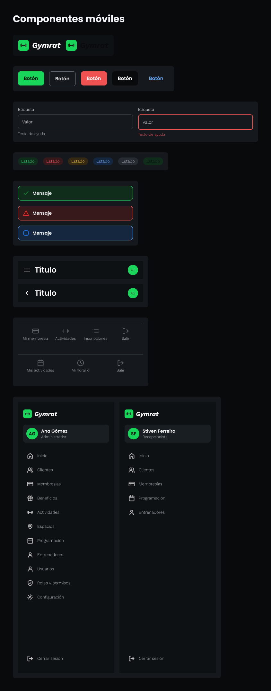
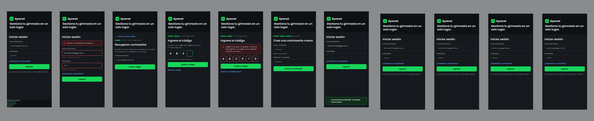
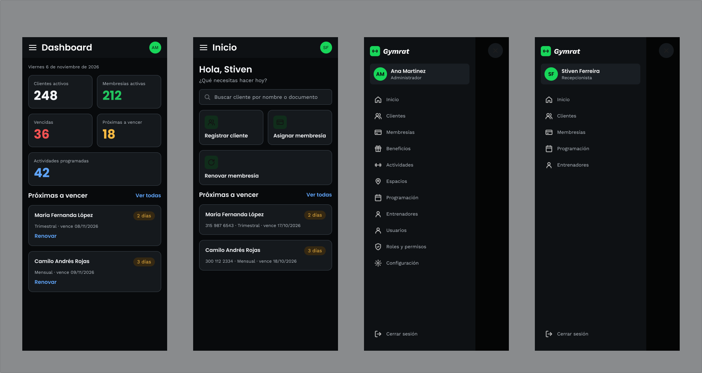
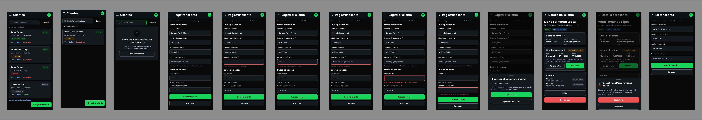
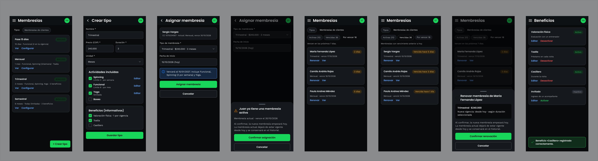
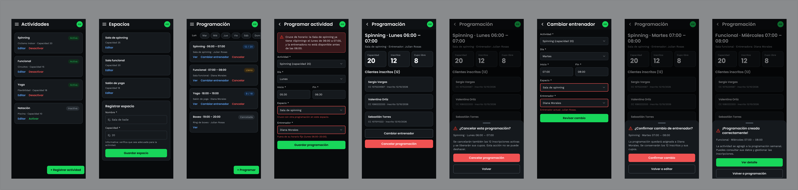
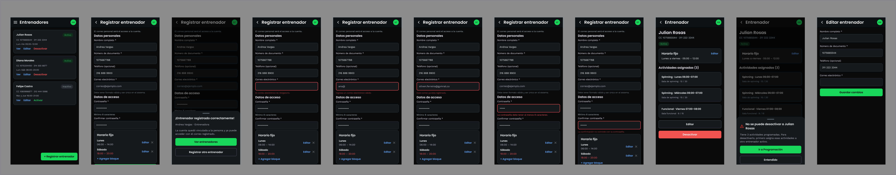
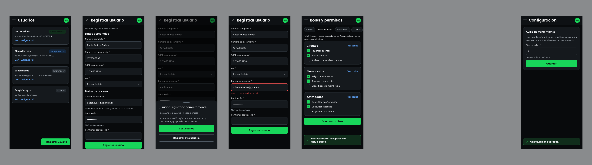
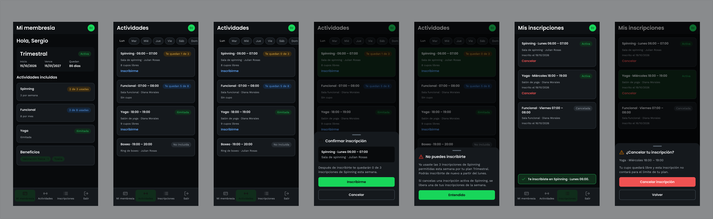
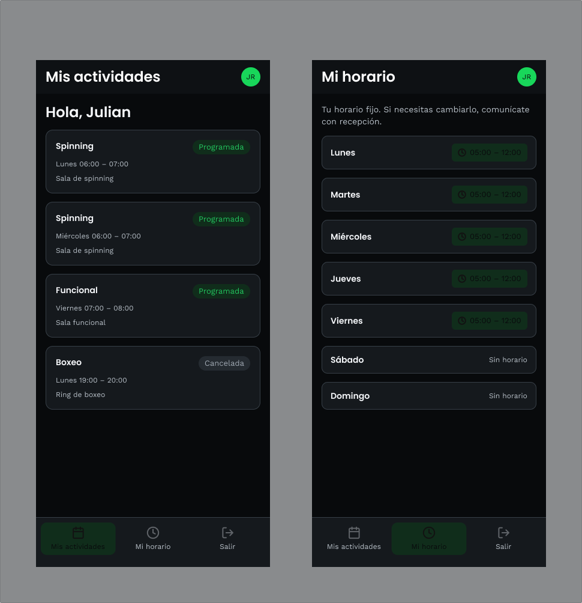

# Diseño de Pantallas — Móvil

## 1. Objetivo

Documentar las pantallas de la versión móvil del Sistema de Gestión de Gimnasio, describiendo su propósito, los elementos principales que contienen y las funcionalidades disponibles según el rol y los permisos del usuario.

La interfaz móvil adapta los flujos de la versión web a un uso táctil con una sola mano: navegación por menú lateral (drawer) o barra inferior según el rol, formularios de una sola columna, listados en tarjetas apiladas y confirmaciones mediante paneles deslizantes (bottom sheets) en lugar de pantallas completas.

## 2. Características de la interfaz móvil

| Elemento | Comportamiento |
|----------|----------------|
| Plataforma | Prototipo móvil para teléfono, de uso táctil. |
| Navegación Admin / Recepcionista | Menú lateral tipo drawer (ícono hamburguesa ☰), con opciones según el rol y los permisos del usuario. |
| Navegación Cliente | Tab bar inferior: Mi membresía · Actividades · Inscripciones · Salir. |
| Navegación Entrenador | Tab bar inferior: Mis actividades · Mi horario · Salir. |
| Header | Título de la sección + avatar del usuario (iniciales) o botón de regreso en pantallas secundarias. |
| Formularios | Una sola columna vertical. Botón principal de acción fijo al final; "Cancelar" o "Volver" debajo. |
| Validación | Mensajes de error en rojo bajo cada campo; el campo afectado se resalta con borde rojo. |
| Listados | Tarjetas (cards) apiladas verticalmente, no tablas. |
| Confirmaciones y alertas | Panel deslizante inferior (bottom sheet) para confirmar acciones sensibles (desactivar, cancelar, renovar, cambiar entrenador). |
| Mensajes de resultado | Notificación tipo toast o tarjeta de confirmación en la parte inferior de la pantalla, con las acciones siguientes disponibles. |
| Control de acceso | Las opciones del menú y las acciones visibles dependen de los permisos del usuario autenticado. |

---

## 3. Grupos de pantallas

### Grupo A. Acceso y recuperación de contraseña

Estas pantallas permiten a los usuarios autenticarse y recuperar el acceso a su cuenta.

| Código | Pantalla | Descripción | Roles |
|---|---|---|---|
| A1 | Iniciar sesión | Formulario para ingresar correo electrónico y contraseña. | Todos |
| A2 | Error de credenciales | Informa que el correo o la contraseña ingresados son incorrectos. | Todos |
| A3 | Recuperar contraseña | Permite solicitar un código de recuperación al correo registrado. | Todos |
| A4 | Ingresar código | Permite introducir el código de 6 dígitos enviado al correo. | Todos |
| A5 | Código inválido o vencido | Informa que el código es incorrecto e indica los intentos restantes. | Todos |
| A6 | Nueva contraseña | Formulario para crear y confirmar una nueva contraseña. | Todos |
| A7 | Confirmación de recuperación | Mensaje sobre el inicio de sesión que confirma que la contraseña se actualizó correctamente. | Todos |

**Consideraciones funcionales:**

- Solo los usuarios activos pueden iniciar sesión.
- El código de recuperación es de un solo uso; se permiten como máximo tres intentos fallidos de validación antes de que el código quede vencido y deba solicitarse uno nuevo.
- Los campos de usuario y contraseña, y el de correo electrónico en el registro de código, se marcan en rojo con el mensaje de error correspondiente ("El correo o la contraseña incorrectos. Verifica tus datos e inténtalo de nuevo.").
- Los mensajes deben indicar claramente los errores y el resultado de la operación.

### Grupo B. Inicio y menús

Estas pantallas presentan las opciones iniciales y la navegación según el perfil del usuario.

| Código | Pantalla | Descripción | Roles |
|---|---|---|---|
| B1 | Dashboard | Resumen con clientes activos, membresías activas, vencidas y próximas a vencer, actividades programadas, y un listado de membresías próximas a vencer. | Administrador |
| B2 | Inicio de recepción | Buscador de clientes por nombre o documento y accesos directos a Registrar cliente, Asignar membresía y Renovar membresía, además del listado de próximas a vencer. | Recepcionista |
| B3 | Menú lateral — Administrador | Drawer con acceso a Inicio, Clientes, Membresías, Beneficios, Actividades, Espacios, Programación, Entrenadores, Usuarios, Roles y permisos, y Configuración. | Administrador |
| B4 | Menú lateral — Recepcionista | Drawer con acceso a Inicio, Clientes, Membresías, Programación y Entrenadores, según los permisos otorgados por el administrador. | Recepcionista |

**Consideraciones funcionales:**

- El dashboard presenta los indicadores definidos en los requerimientos y refleja los días de aviso configurados para las "próximas a vencer".
- El inicio de recepción prioriza las acciones más frecuentes de atención al cliente como accesos directos.
- El contenido del menú lateral depende de los permisos del usuario; no deben mostrarse opciones que el usuario no tenga autorización para usar.

### Grupo C. Gestión de clientes

Estas pantallas permiten registrar, consultar y administrar los datos de los clientes.

| Código | Pantalla | Descripción | Roles |
|---|---|---|---|
| C1 | Listado de clientes | Presenta los clientes registrados en tarjetas, con buscador por nombre o documento y acciones de Ver, Editar y Desactivar o Activar. | Administrador, Recepcionista |
| C2 | Búsqueda sin resultados | Informa que no se encontraron coincidencias y ofrece registrar al cliente si es nuevo. | Administrador, Recepcionista |
| C3 | Registrar cliente | Formulario de una columna con datos personales y datos de acceso (correo y contraseña) para crear al cliente y su credencial. | Administrador, Recepcionista |
| C4 | Detalle de cliente | Muestra los datos de contacto, la membresía actual y el historial del cliente, con accesos a Asignar otra, Renovar, Editar y Desactivar. | Administrador, Recepcionista |
| C5 | Editar cliente | Permite actualizar los datos personales y de contacto del cliente. | Administrador, Recepcionista según permisos |
| C6 | Confirmar desactivación | Panel deslizante que solicita confirmar el cambio de estado del cliente. | Administrador |

**Consideraciones funcionales:**

- El registro requiere nombre completo, número de documento y correo electrónico (el teléfono es opcional); el correo será el acceso del cliente.
- El sistema valida formato de correo, unicidad del correo y de la contraseña (mínimo 8 caracteres, con confirmación) antes de guardar, mostrando el error bajo el campo correspondiente (por ejemplo, "Este correo ya está registrado.").
- Al registrar correctamente, la cuenta queda vinculada y el cliente puede acceder de inmediato con el correo registrado.
- Un cliente inactivo no puede iniciar sesión; desactivarlo conserva su historial y permite reactivarlo después.
- La desactivación siempre solicita confirmación previa en un panel deslizante.

### Grupo D. Gestión de membresías y beneficios

Estas pantallas permiten configurar los tipos de membresía, administrar sus beneficios y gestionar la vigencia de las membresías asignadas a los clientes.

| Código | Pantalla | Descripción | Roles |
|---|---|---|---|
| D1 | Tipos de membresía | Presenta el catálogo de membresías mediante pestañas (Tipos / Membresías de clientes). | Administrador, Recepcionista |
| D2 | Crear o configurar tipo de membresía | Formulario para definir nombre, precio, duración y unidad, junto con las actividades incluidas (con su límite) y los beneficios informativos de la membresía. | Administrador |
| D3 | Asignar membresía | Permite seleccionar el tipo de membresía y la fecha de inicio para un cliente, mostrando la vigencia resultante. | Administrador, Recepcionista |
| D4 | Confirmar asignación o reemplazo | Panel deslizante que informa cuándo el cliente ya tiene una membresía activa y solicita confirmar el reemplazo. | Administrador, Recepcionista |
| D5 | Membresías por estado | Permite consultar, mediante filtros (Activas, Vencidas, Por vencer), las membresías de los clientes con acceso directo a Renovar o Ver. | Administrador, Recepcionista |
| D6 | Renovar membresía | Panel deslizante que confirma la nueva vigencia a registrar para la membresía del cliente. | Administrador, Recepcionista |
| D7 | Beneficios | Presenta el catálogo de beneficios del gimnasio, con acciones de Editar y Desactivar o Activar. | Administrador |

**Consideraciones funcionales:**

- La duración de una membresía se define en días o meses; la fecha de vencimiento se calcula de acuerdo con la duración configurada.
- Un cliente puede tener como máximo una membresía activa. Si se le asigna una nueva mientras tiene otra vigente, el sistema solicita confirmar el reemplazo antes de continuar (la membresía anterior queda en el historial como "Reemplazada").
- La renovación registra una nueva vigencia desde la fecha actual.
- Los límites de inscripción de las actividades incluidas pueden definirse por período o configurarse sin límite (ilimitada).
- Los beneficios son informativos; no existe un módulo para controlar su utilización.
- La gestión de membresías no incluye el procesamiento de pagos.

### Grupo E. Actividades, espacios y programación

Estas pantallas permiten administrar las actividades del gimnasio, los espacios disponibles y su programación.

| Código | Pantalla | Descripción | Roles |
|---|---|---|---|
| E1 | Catálogo de actividades | Presenta las actividades registradas, su capacidad y estado, con acciones de Editar, Desactivar o Activar, y Registrar actividad. | Administrador |
| E2 | Espacios | Presenta los espacios registrados con su capacidad, con un formulario para registrar uno nuevo. | Administrador |
| E3 | Programación semanal | Presenta la programación por día de la semana (Lun a Dom), con el estado de cada franja (cupos, Lleno, Cancelada) y accesos a Ver, Cambiar entrenador y Cancelar. | Administrador, Recepcionista según permisos |
| E4 | Programar actividad | Formulario para definir actividad, día, hora de inicio y fin, espacio y entrenador. | Administrador |
| E5 | Detalle de programación e inscritos | Muestra capacidad, inscritos y cupo libre de una franja, y el listado de clientes inscritos. | Administrador, Recepcionista según permisos |
| E6 | Confirmar cancelación | Panel deslizante que advierte que se cancelarán también las inscripciones activas asociadas. | Administrador |
| E7 | Cambiar entrenador | Formulario para reemplazar el entrenador asignado a una franja programada. | Administrador |
| E8 | Confirmar cambio de entrenador | Panel deslizante que confirma el cambio y aclara que se conservan los inscritos y sus cupos. | Administrador |
| E9 | Confirmación de programación creada | Mensaje que confirma que la actividad se agregó a la programación semanal. | Administrador |

**Consideraciones funcionales:**

- La hora de finalización debe ser posterior a la hora de inicio.
- La programación no puede generar cruces de horario en un mismo espacio (por ejemplo: "Cruce de horario: la Sala de spinning ya tiene «Spinning» el lunes de 06:00 a 07:00").
- El entrenador debe estar activo y disponible dentro de su horario fijo; el sistema marca en rojo la selección cuando está "Fuera de su horario fijo".
- Un entrenador no puede tener programaciones que se crucen entre sí.
- La capacidad de la actividad y la del espacio deben respetarse; al alcanzarse el límite, la franja se muestra como "Lleno".
- Al cancelar una programación, el sistema cancela automáticamente sus inscripciones activas y libera los cupos; esta acción no se puede deshacer.
- El sistema informa los errores de validación antes de completar una operación que incumpla las reglas establecidas.

### Grupo F. Gestión de entrenadores

Estas pantallas permiten administrar los datos de los entrenadores, su horario fijo y sus asignaciones.

| Código | Pantalla | Descripción | Roles |
|---|---|---|---|
| F1 | Listado de entrenadores | Presenta los entrenadores registrados, su horario y estado, con acciones de Ver, Editar y Desactivar o Activar. | Administrador, Recepcionista |
| F2 | Registrar entrenador | Formulario con datos personales, datos de acceso y la configuración del horario fijo por bloques de días y horas. | Administrador, Recepcionista |
| F3 | Confirmación de registro | Mensaje que confirma que la cuenta del entrenador quedó vinculada y lista para acceder. | Administrador, Recepcionista |
| F4 | Detalle de entrenador | Muestra el horario fijo y las actividades asignadas, con accesos a Editar y Desactivar. | Administrador, Recepcionista |
| F5 | Editar entrenador | Permite actualizar los datos personales y de contacto del entrenador. | Administrador |
| F6 | Desactivación no permitida | Panel deslizante que bloquea la desactivación mientras el entrenador tenga actividades programadas, con acceso directo a la programación. | Administrador |

**Consideraciones funcionales:**

- El registro requiere nombre, documento y correo electrónico (el teléfono es opcional); el documento y el correo deben ser únicos.
- El entrenador debe tener un horario fijo registrado (por bloques de día y hora) para validar sus programaciones.
- Antes de desactivar un entrenador con actividades programadas, estas deben reasignarse a otro entrenador activo; el sistema impide la desactivación y explica el motivo ("Tiene N actividades programadas. Para desactivarlo, primero asigna esas actividades a otro entrenador activo.").
- El entrenador consulta sus propias actividades y horarios desde las vistas correspondientes a su rol (Grupo I), no desde esta gestión.

### Grupo G. Usuarios, roles, permisos y configuración

Estas pantallas permiten administrar las cuentas de acceso administrativas y configurar los permisos y avisos del sistema.

| Código | Pantalla | Descripción | Roles |
|---|---|---|---|
| G1 | Listado de usuarios | Presenta las cuentas registradas con su rol, con acceso a Ver y Asignar rol. | Administrador |
| G2 | Registrar usuario administrativo | Formulario para crear usuarios con rol de Administrador o Recepcionista. | Administrador |
| G3 | Roles y permisos | Permite consultar, por pestaña de rol, los permisos agrupados por módulo (Clientes, Membresías, Actividades, etc.) y activarlos o desactivarlos. | Administrador |
| G4 | Configuración de avisos | Permite establecer los días de anticipación para considerar una membresía "próxima a vencer". | Administrador |

**Consideraciones funcionales:**

- El sistema contempla cuatro roles fijos: Administrador, Recepcionista, Entrenador y Cliente.
- Las credenciales de acceso de clientes y entrenadores se generan automáticamente al registrarlos (Grupos C y F); esta sección administra únicamente las cuentas de Administrador y Recepcionista.
- El rol Administrador hereda las operaciones del Recepcionista y suma los permisos exclusivos de administración.
- Las opciones disponibles en el menú y en cada pantalla deben respetar los permisos asignados a cada rol.
- La configuración de días de aviso se refleja en las consultas de membresías (Grupo D) y en el dashboard (Grupo B).

### Grupo H. Vistas del cliente

Estas pantallas permiten al cliente consultar su información, revisar las actividades disponibles y administrar sus propias inscripciones.

| Código | Pantalla | Descripción | Roles |
|---|---|---|---|
| H1 | Mi membresía | Presenta el saludo del cliente, el tipo de membresía, vigencia, actividades incluidas (con uso) y beneficios. | Cliente |
| H2 | Actividades disponibles | Presenta la programación semanal por día, con los cupos disponibles de cada actividad y la opción de inscribirse. | Cliente |
| H3 | Confirmar inscripción | Panel deslizante que confirma la inscripción y cuántos cupos del límite semanal quedarán disponibles. | Cliente |
| H4 | Restricción de inscripción | Panel deslizante que informa cuando se alcanzó el límite de inscripciones de la actividad o no hay cupos disponibles. | Cliente |
| H5 | Mis inscripciones | Presenta las actividades en las que el cliente tiene inscripciones, con su estado (Activa, Cancelada) y la opción de cancelar. | Cliente |
| H6 | Cancelar inscripción | Panel deslizante que solicita confirmar la cancelación de una inscripción propia. | Cliente |

**Consideraciones funcionales:**

- El cliente solo puede consultar su propia información.
- Para inscribirse, debe tener una membresía activa que incluya la actividad, disponer de cupos dentro del límite de su plan y que la franja tenga cupo disponible.
- No se permite mantener más de una inscripción activa en la misma programación.
- La cancelación libera el cupo y deja de contar para el límite de inscripciones del cliente.
- Los mensajes explican con el detalle del plan por qué no se permite una inscripción cuando no se cumplen las condiciones.

### Grupo I. Vistas del entrenador

Estas pantallas permiten al entrenador consultar sus actividades asignadas y su horario.

| Código | Pantalla | Descripción | Roles |
|---|---|---|---|
| I1 | Mis actividades | Presenta, a modo de saludo, las actividades programadas asignadas al entrenador autenticado y su estado. | Entrenador |
| I2 | Mi horario | Presenta los días y horas de su horario fijo; los días sin disponibilidad se marcan como "Sin horario". | Entrenador |

**Consideraciones funcionales:**

- El entrenador solo accede a las funcionalidades autorizadas para su perfil, mediante la tab bar inferior (Mis actividades · Mi horario · Salir).
- Las consultas corresponden únicamente a sus propias asignaciones.
- La interfaz es de consulta: el entrenador no puede modificar su programación ni su horario fijo desde estas vistas; cualquier cambio debe solicitarlo a recepción o administración.

## 4. Reglas generales de las pantallas móviles

- Las pantallas protegidas requieren que el usuario haya iniciado sesión.
- La navegación (menú lateral o barra inferior) y las acciones visibles deben respetar el rol y los permisos configurados del usuario autenticado.
- Los formularios se presentan en una sola columna, con el botón de acción principal fijo y las validaciones mostradas en rojo bajo cada campo.
- Las confirmaciones de acciones sensibles (desactivar, cancelar, renovar, reemplazar, cambiar entrenador) se resuelven en paneles deslizantes (bottom sheets), nunca de forma automática.
- Los resultados de las operaciones se informan mediante mensajes de confirmación o notificaciones tipo toast, que incluyen las acciones siguientes disponibles (por ejemplo, "Ver clientes" o "Registrar otro cliente").
- Los listados se presentan como tarjetas apiladas que facilitan la consulta y el acceso directo a las acciones autorizadas.
- Las pantallas mantienen una presentación coherente en encabezados, botones, formularios y mensajes.
- Las acciones de modificación o desactivación están disponibles únicamente para los roles autorizados.
- No deben agregarse funcionalidades de pagos ni de control de asistencia, ya que no forman parte del alcance funcional definido para esta documentación.

## 5. Evidencias gráficas del prototipo móvil

### 5.1. Componentes

### 5.2. Acceso y recuperación de contraseña

### 5.3. Inicio y menús

### 5.4. Gestión de clientes

### 5.5. Gestión de membresías y beneficios

### 5.6. Actividades, espacios y programación

### 5.7. Gestión de entrenadores

### 5.8. Usuarios, permisos y configuración

### 5.9. Vistas del cliente

### 5.10. Vistas del entrenador

