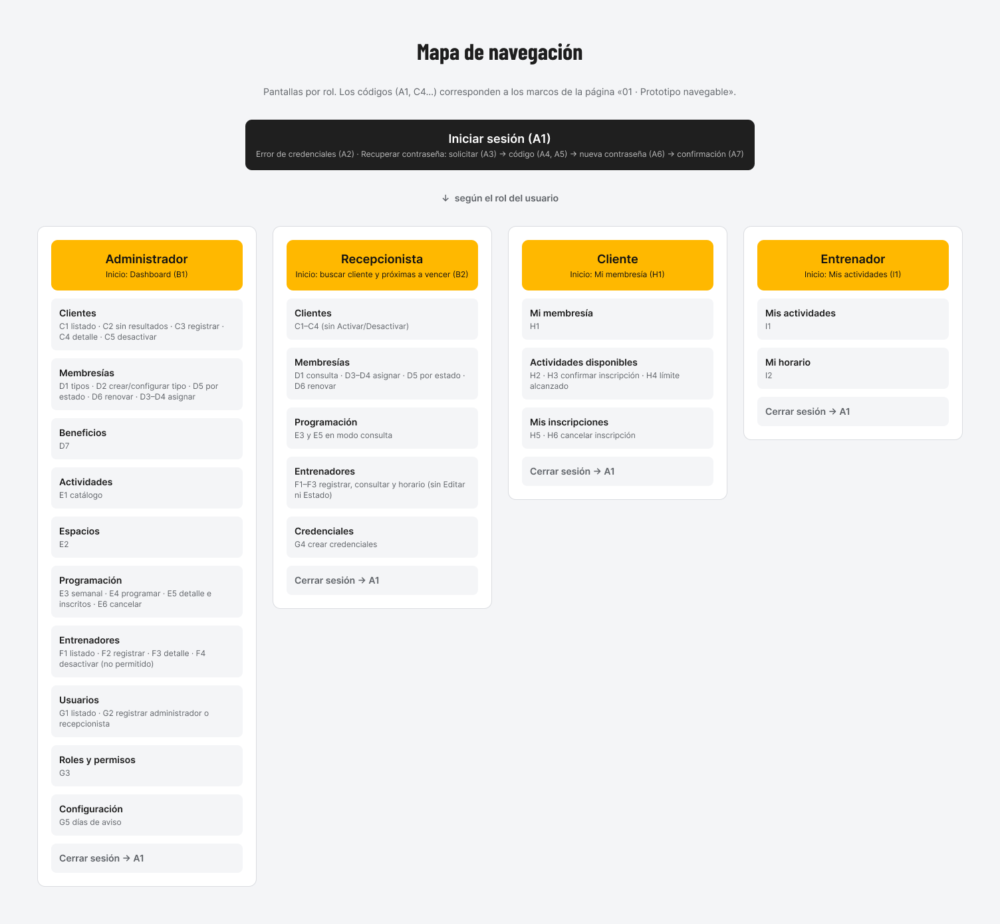
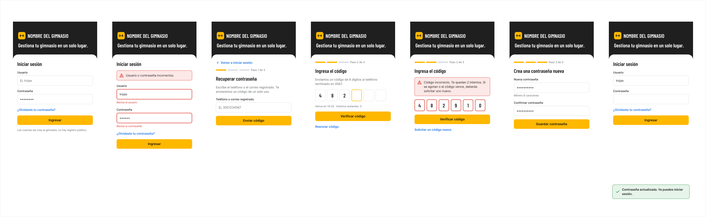
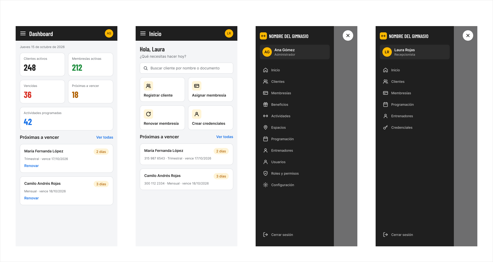
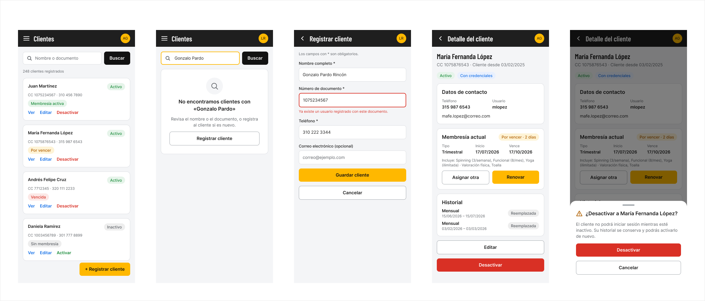
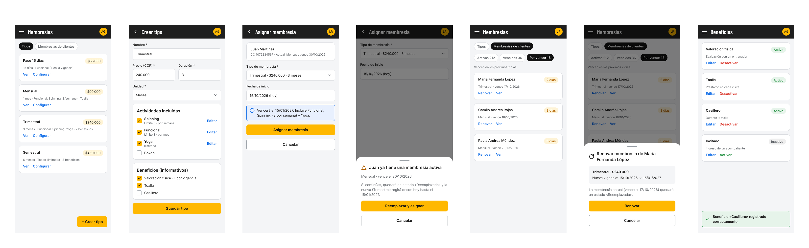
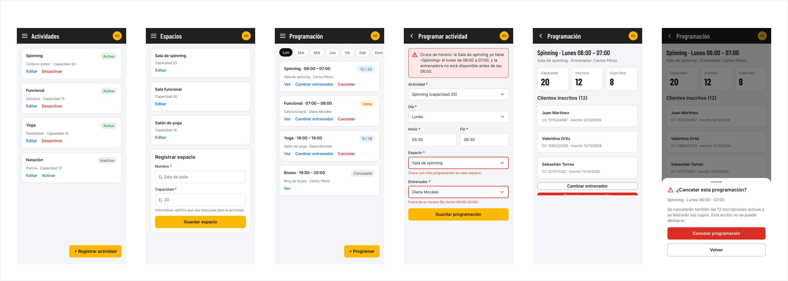
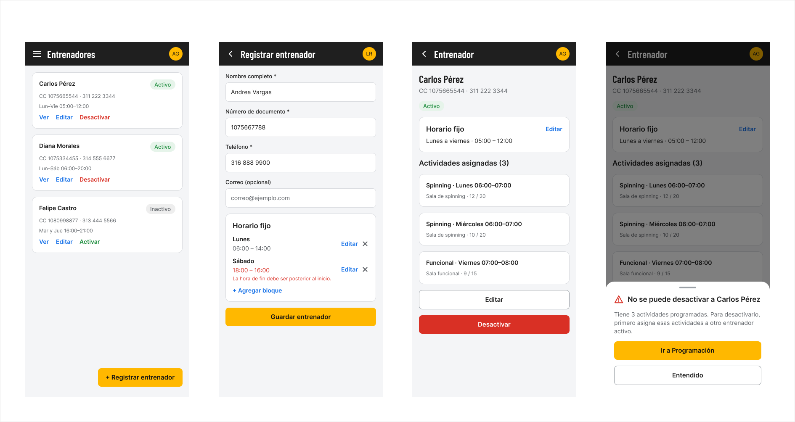
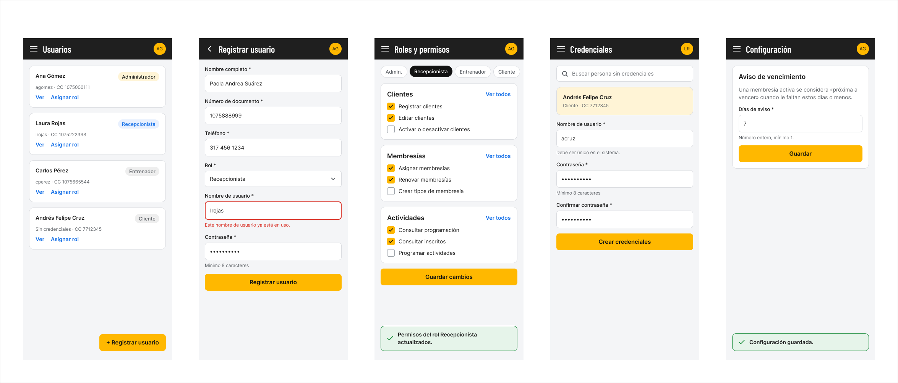
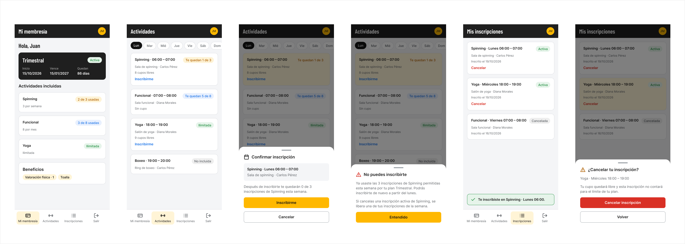
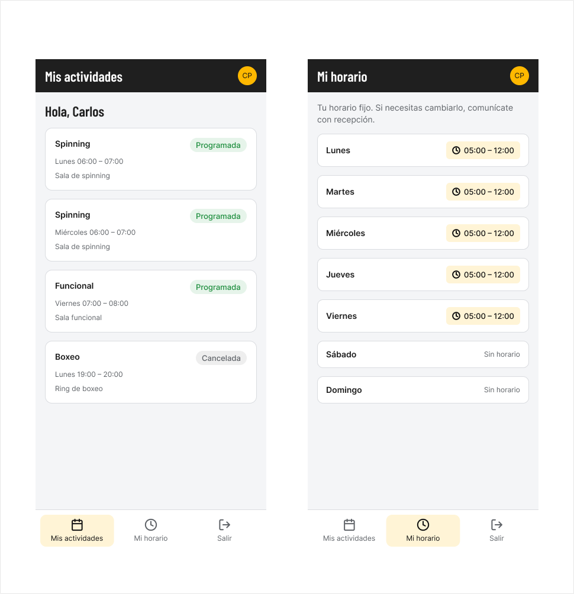

# Diseño de Pantallas — Móvil

Prototipo móvil del Sistema de Gestión de Gimnasio, adaptado a pantalla táctil y uso con una mano.

## Características de la interfaz móvil

| Elemento | Comportamiento |
|----------|----------------|
| Navegación Admin / Recepcionista | Menú lateral tipo drawer (ícono hamburguesa) |
| Navegación Cliente | Tab Bar inferior: Mi membresía · Actividades · Inscripciones · Salir |
| Navegación Entrenador | Tab Bar inferior: Mis actividades · Mi horario · Salir |
| Formularios | Una sola columna vertical. Botones fijos en la parte inferior (sticky) |
| Listados | Cards apiladas |
| Header | Título de la sección + avatar del usuario o botón de regreso |

---

## Grupos de pantallas

### Grupo A · Acceso
| Código | Pantalla | Descripción |
|--------|----------|-------------|
| A1 | Iniciar sesión | Formulario de usuario y contraseña |
| A2 | Error de credenciales | Mensaje de error en el login |
| A3 | Recuperar contraseña | Solicitar código por teléfono o correo |
| A4 / A5 | Ingresar código | Validación del código de 6 dígitos |
| A6 | Nueva contraseña | Crear y confirmar nueva contraseña |
| A7 | Confirmación | Contraseña actualizada correctamente |

### Grupo B · Inicio y menús
| Código | Pantalla | Roles |
|--------|----------|-------|
| B1 | Dashboard / Inicio Administrador | Administrador |
| B2 | Inicio Recepcionista (buscar cliente / próximas a vencer) | Recepcionista |

### Grupo C · Clientes
| Código | Pantalla |
|--------|----------|
| C1 | Listado de clientes |
| C2 | Sin resultados |
| C3 | Registrar cliente |
| C4 | Detalle de cliente |
| C5 | Desactivar cliente |

### Grupo D · Membresías y Beneficios
| Código | Pantalla |
|--------|----------|
| D1 | Tipos de membresía |
| D2 | Crear / configurar tipo de membresía |
| D3 / D4 | Asignar membresía |
| D5 | Membresías por estado |
| D6 | Renovar membresía |
| D7 | Beneficios |

### Grupo E · Actividades, Espacios y Programación
| Código | Pantalla |
|--------|----------|
| E1 | Catálogo de actividades |
| E2 | Espacios |
| E3 | Programación semanal |
| E4 | Programar actividad |
| E5 | Detalle e inscritos |
| E6 | Cancelar programación |

### Grupo F · Entrenadores
| Código | Pantalla |
|--------|----------|
| F1 | Listado de entrenadores |
| F2 | Registrar entrenador |
| F3 | Detalle de entrenador |
| F4 | Desactivar entrenador |

### Grupo G · Usuarios, Permisos y Configuración
| Código | Pantalla |
|--------|----------|
| G1 | Listado de usuarios |
| G2 | Registrar administrador o recepcionista |
| G3 | Roles y permisos |
| G4 | Crear credenciales |
| G5 | Configuración (días de aviso) |

### Grupo H · Vistas del Cliente
| Código | Pantalla |
|--------|----------|
| H1 | Mi membresía |
| H2 | Actividades disponibles |
| H3 | Confirmar inscripción |
| H4 | Límite de cupos alcanzado |
| H5 | Mis inscripciones |
| H6 | Cancelar inscripción |

### Grupo I · Vistas del Entrenador
| Código | Pantalla |
|--------|----------|
| I1 | Mis actividades |
| I2 | Mi horario |

---

## Evidencias gráficas

### Componentes

### Mapa de navegación

### Acceso

### Inicio y menús

### Clientes

### Membresías y beneficios

### Actividades, espacios y programación

### Entrenadores

### Usuarios, permisos y configuración

### Vistas del Cliente

### Vistas del Entrenador

