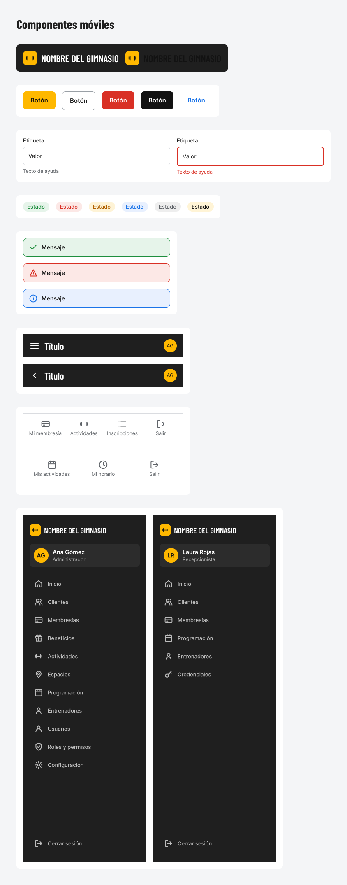

# Componentes Visuales — Móvil

## Logo
- Componente principal con el nombre del gimnasio (editable)
- Variantes en fondo oscuro y claro

## Botones
| Tipo | Color | Uso |
|------|-------|-----|
| Primario | Amarillo | Guardar, Ingresar, Confirmar |
| Secundario | Outline / blanco | Cancelar, Volver |
| Destructivo | Rojo | Eliminar, Desactivar |
| Negro | Negro | Acciones secundarias importantes |
| Texto | Azul | Enlaces (¿Olvidaste tu contraseña?) |

## Campos de formulario
- Estado normal
- Estado de error (borde rojo + texto de ayuda en rojo)

## Insignias de estado (Badges)
- 🟢 Verde → Activo / Vigente
- 🔴 Rojo → Inactivo / Vencido / Error
- 🟡 Amarillo → Pendiente / Próximo a vencer
- 🔵 Azul → Información
- ⚪ Gris → Neutral

## Avisos del sistema
- Éxito (verde)
- Error (rojo)
- Información (azul)

## Navegación móvil

### Header
- Título de la sección
- Avatar del usuario (círculo con iniciales)
- Botón de menú (hamburguesa) o botón de regreso

### Menú lateral (Drawer)
Usado por **Administrador** y **Recepcionista**:
- Logo del gimnasio
- Nombre y rol del usuario
- Lista de opciones según permisos
- Botón “Cerrar sesión” al final

### Tab Bar inferior
Usado por **Cliente** y **Entrenador**:

**Cliente:**
- Mi membresía
- Actividades
- Inscripciones
- Salir

**Entrenador:**
- Mis actividades
- Mi horario
- Salir

## Paleta principal
- Primario: Amarillo
- Fondos de menú y headers: Negro / Gris muy oscuro
- Textos: Blanco y grises

## Catálogo de componentes

