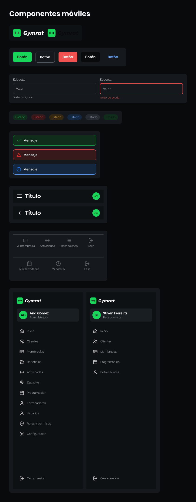

# Componentes Visuales — Móvil

## Logo
- Ícono cuadrado redondeado en verde con glifo de mancuerna, acompañado del wordmark **Gymrat** (itálica, negrita).
- Dos variantes:
  - **Fondo oscuro**: wordmark en blanco.
  - **Fondo claro**: wordmark en texto oscuro.
- El nombre del gimnasio es editable.

## Botones
| Tipo | Apariencia | Uso |
|------|------------|-----|
| Primario | Fondo verde, texto oscuro | Ingresar, Guardar, Confirmar, Registrar |
| Secundario | Borde gris, fondo oscuro, texto blanco | Cancelar, Volver, Entendido, Ir a Programación |
| Destructivo | Fondo rojo, texto blanco | Desactivar, Cancelar programación, Cancelar inscripción |
| Negro | Fondo negro, texto blanco | Acciones secundarias importantes |
| Texto | Texto azul, sin fondo | Enlaces (¿Olvidaste tu contraseña?), Ver, Editar, Ver todos |

## Campos de formulario
- **Normal**: borde gris sutil, fondo oscuro, valor en blanco, texto de ayuda gris debajo.
- **Error**: borde rojo + texto de ayuda en rojo debajo (p. ej. "Este correo ya está registrado.").

## Insignias de estado (Badges)
- 🟢 Verde → Activo / Vigente / Programada
- 🔴 Rojo → Vencida / Error
- 🟡 Ámbar → Por vencer / Pendiente
- 🔵 Azul → Información (p. ej. "Con credenciales")
- ⚪ Gris → Inactivo / Cancelada / Lleno / Neutral

## Avisos del sistema
El catálogo define tres tipos:
- **Éxito** (verde, ícono de check): p. ej. "Permisos del rol Recepcionista actualizados."
- **Error** (rojo, ícono de alerta): p. ej. errores de validación o conflictos.
- **Información** (azul, ícono de info): datos contextuales.

Los paneles deslizantes inferiores (bottom sheets) de confirmación usan un ícono de advertencia, en rojo o en ámbar según la pantalla. El catálogo no define un tipo de aviso ámbar; ese criterio queda por definir.

## Navegación móvil

### Header
- Título de la sección a la izquierda.
- Avatar del usuario a la derecha: círculo verde con iniciales.
- Botón de menú (hamburguesa ☰) en pantallas raíz, o flecha de regreso (‹) en pantallas secundarias.

### Menú lateral (Drawer)
Usado por **Administrador** y **Recepcionista**:
- Logo Gymrat en la parte superior.
- Tarjeta de usuario: avatar con iniciales, nombre y rol.
- Lista de opciones según permisos:
  - **Administrador**: Inicio, Clientes, Membresías, Beneficios, Actividades, Espacios, Programación, Entrenadores, Usuarios, Roles y permisos, Configuración.
  - **Recepcionista**: Inicio, Clientes, Membresías, Programación, Entrenadores.
- Botón "Cerrar sesión" al final.

### Tab Bar inferior
Usado por **Cliente** y **Entrenador**:

**Cliente:** Mi membresía · Actividades · Inscripciones · Salir

**Entrenador:** Mis actividades · Mi horario · Salir

### Panel deslizante inferior (Bottom sheet)
Usado para confirmaciones y resultados que no requieren salir de la pantalla actual: confirmar inscripción, cancelar, renovar, registro exitoso, advertencias antes de desactivar o reemplazar. Incluye ícono de estado, texto explicativo y uno o dos botones.

## Paleta principal
- Primario: Verde (logo, botones primarios, avatar, estado activo).
- Destructivo: Rojo.
- Enlaces y acciones de listado: Azul.
- Fondos de menú y headers: Negro / gris muy oscuro.
- Textos: Blanco y grises.
## Catálogo de componentes

