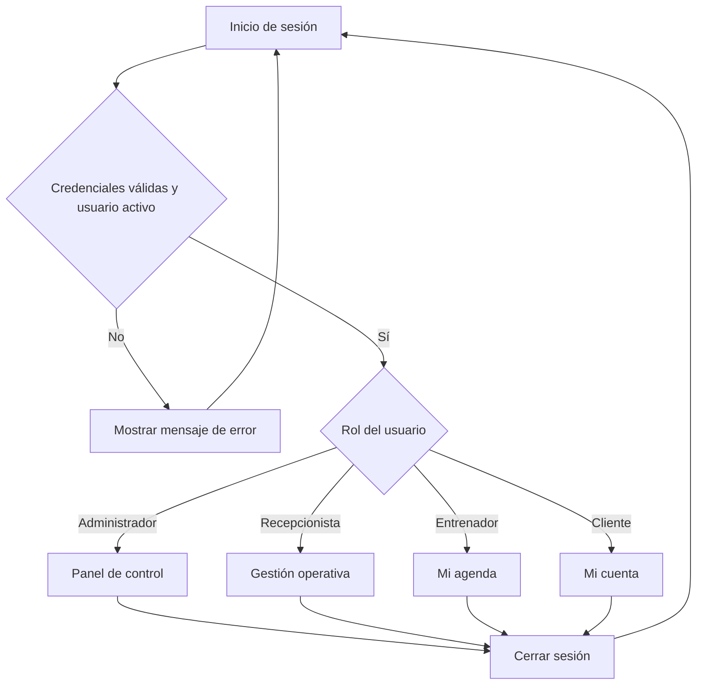
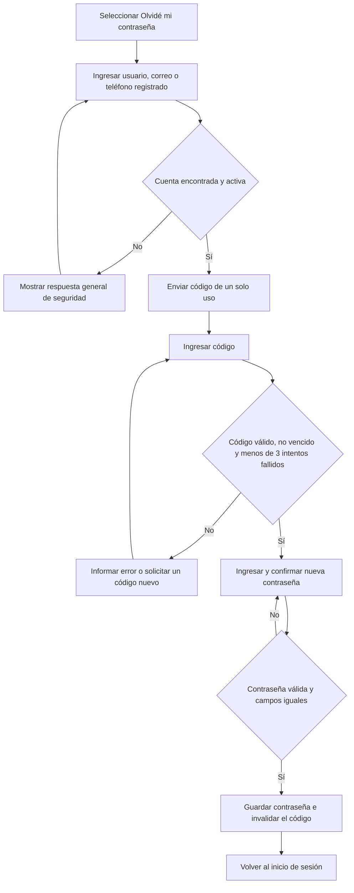
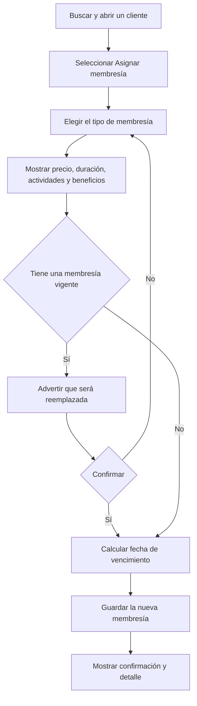
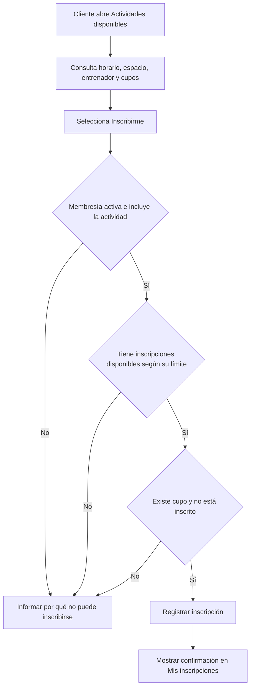

# Flujos de usuario del Sistema de Gestión de Gimnasio

## 1. Objetivo

Este documento explica cómo navegan los usuarios entre las pantallas del sistema. Los flujos respetan los cuatro roles definidos: Administrador, Recepcionista, Entrenador y Cliente.

## 2. Flujo general de navegación

El sistema solo presenta las opciones autorizadas para el rol y sus permisos. Al cerrar sesión se bloquea el acceso a las pantallas protegidas hasta que el usuario vuelva a autenticarse.

## 3. Inicio de sesión

**Actor:** cualquier usuario con credenciales.

1. El usuario abre la pantalla `Iniciar sesión`.
2. Ingresa nombre de usuario y contraseña.
3. Selecciona `Iniciar sesión`.
4. El sistema valida que las credenciales sean correctas y que el usuario esté activo.
5. Si la información es válida, dirige al inicio correspondiente al rol.
6. Si es inválida, muestra un mensaje sin indicar cuál dato fue incorrecto.
7. Si el usuario está inactivo, se rechaza el acceso.

**Resultado exitoso:** sesión iniciada y menú adaptado a los permisos.

## 4. Recuperación de contraseña

El código vence después de 15 minutos y admite máximo tres intentos fallidos. La nueva contraseña y su confirmación deben coincidir y cumplir las reglas de seguridad definidas por el sistema.

## 5. Gestión de clientes

**Actores:** Administrador y Recepcionista. La desactivación corresponde al Administrador.

### 5.1. Registrar cliente

1. Ir a `Clientes` y seleccionar `Registrar cliente`.
2. Completar nombre, documento y teléfono; el correo es opcional.
3. Seleccionar `Guardar cliente`.
4. El sistema valida los campos y comprueba que el documento no esté registrado.
5. Si hay errores, los muestra junto a los campos y conserva los datos ingresados.
6. Si todo es correcto, guarda el cliente, muestra la confirmación y abre su detalle.

### 5.2. Consultar, buscar y editar

1. Entrar a `Clientes`.
2. Buscar por nombre o documento o recorrer el listado.
3. Seleccionar un cliente para ver su información y membresía.
4. Elegir `Editar`, modificar los datos y guardar.
5. El sistema valida y confirma la actualización.

Si no existen coincidencias, se presenta el mensaje `No se encontraron clientes` y la opción `Limpiar búsqueda`.

### 5.3. Cambiar estado

1. El Administrador abre el detalle del cliente.
2. Selecciona `Desactivar` o `Activar`.
3. Confirma la decisión.
4. El sistema cambia el estado y actualiza la etiqueta visual.

Un cliente inactivo no puede iniciar sesión.

## 6. Gestión de membresías

**Actores:** Administrador y Recepcionista para asignar, consultar y renovar. El Administrador gestiona tipos, beneficios y actividades incluidas.

### 6.1. Asignar membresía

### 6.2. Renovar membresía

1. Abrir el cliente y consultar su membresía.
2. Seleccionar `Renovar membresía`.
3. Revisar o escoger el tipo de membresía.
4. Confirmar la renovación.
5. El sistema registra la nueva vigencia desde la fecha actual y deja la anterior en estado `Reemplazada`.
6. Se muestra la nueva fecha de vencimiento.

### 6.3. Consultar por estado

Desde `Membresías`, el Administrador o Recepcionista filtra por `Activa`, `Vencida`, `Próxima a vencer`, `Cancelada` o `Reemplazada`. La vista presenta cliente, plan, estado, fecha de inicio y fecha de vencimiento.

## 7. Programación de actividades

**Actor principal:** Administrador. El Recepcionista y el Cliente pueden consultar las actividades programadas; el Entrenador consulta las suyas.

### 7.1. Crear programación

1. Ir a `Programaciones` y seleccionar `Nueva programación`.
2. Elegir actividad, día, hora de inicio, hora de fin, espacio y entrenador.
3. Seleccionar `Guardar programación`.
4. El sistema comprueba que:
   - la hora de fin sea posterior a la de inicio;
   - el espacio no tenga un cruce de horario;
   - el entrenador esté activo;
   - el entrenador no tenga otro compromiso en ese horario;
   - la programación esté dentro del horario fijo del entrenador.
5. Si una validación falla, se informa el motivo para corregirlo.
6. Si todas se cumplen, se registra la programación y se muestra en el calendario o listado.

### 7.2. Cambiar entrenador

El Administrador abre la programación, selecciona `Cambiar entrenador`, elige otro entrenador y guarda. Se vuelven a validar el estado, el horario fijo y los cruces antes de confirmar el cambio.

### 7.3. Cancelar programación

El Administrador selecciona `Cancelar programación`, revisa la advertencia y confirma. La programación y sus inscripciones activas pasan a estado `Cancelada` en una sola operación.

## 8. Inscripción a actividades

**Actor principal:** Cliente. El Administrador y el Recepcionista pueden consultar las personas inscritas.

### 8.1. Inscribirse

### 8.2. Cancelar inscripción

1. El Cliente entra a `Mis inscripciones`.
2. Selecciona una inscripción activa y pulsa `Cancelar inscripción`.
3. Revisa la confirmación y acepta.
4. El sistema cambia el estado a `Cancelada`, libera el cupo y deja de contarla para el límite del plan.
5. La pantalla actualiza el estado y muestra la confirmación.

### 8.3. Consultar inscritos

El Administrador o Recepcionista abre una actividad programada y selecciona `Ver inscritos`. El sistema muestra el total y el listado de clientes con inscripción activa.

## 9. Recorridos por rol

### 9.1. Administrador

1. Inicia sesión y entra al `Panel de control`.
2. Consulta los indicadores de clientes, membresías y actividades.
3. Desde el menú puede administrar clientes, membresías, actividades, espacios, programaciones y entrenadores.
4. También puede crear usuarios administrativos, asignar roles, configurar permisos y definir los días de aviso de vencimiento.
5. Cierra sesión desde el encabezado.

**Ejemplo de recorrido diario:** Panel → Membresías próximas a vencer → Detalle del cliente → Renovar membresía → Confirmar → Panel.

### 9.2. Recepcionista

1. Inicia sesión y accede a la gestión operativa.
2. Busca o registra clientes.
3. Consulta, asigna o renueva membresías.
4. Consulta programaciones e inscritos.
5. Registra entrenadores, consulta sus datos y define horarios según sus permisos.
6. Cierra sesión.

**Ejemplo de recorrido:** Clientes → Registrar cliente → Detalle → Asignar membresía → Crear credenciales → Confirmación.

### 9.3. Entrenador

1. Inicia sesión y llega a `Mi agenda`.
2. Consulta sus actividades programadas por día y hora.
3. Abre una actividad para revisar su información, espacio y horario.
4. Consulta sus bloques de horario fijo.
5. Cierra sesión.

El Entrenador no administra clientes, membresías ni programaciones.

### 9.4. Cliente

1. Inicia sesión y entra a `Mi cuenta`.
2. Consulta su perfil y el estado, beneficios, actividades incluidas y vencimiento de su membresía.
3. Entra a `Actividades disponibles`, revisa horarios, entrenador, cupos y límites de su plan.
4. Se inscribe en una actividad válida.
5. Consulta o cancela la inscripción desde `Mis inscripciones`.
6. Cierra sesión.

**Ejemplo de recorrido:** Mi membresía → Actividades disponibles → Detalle → Inscribirme → Confirmación → Mis inscripciones.

## 10. Manejo común de situaciones especiales

| Situación | Respuesta del sistema |
|---|---|
| Datos obligatorios vacíos | Marcar los campos y explicar qué falta |
| Documento duplicado | Rechazar el registro e informar que ya existe |
| Sesión vencida | Informar y dirigir al inicio de sesión |
| Falta de permisos | Bloquear la acción y mostrar un mensaje claro |
| Membresía no válida para una actividad | Explicar si está vencida, no incluye la actividad o agotó el límite |
| Actividad sin cupo | Impedir la inscripción e indicar que no hay cupos |
| Cruce de horario | Rechazar la programación e identificar el conflicto |
| Error inesperado | Conservar los datos posibles, informar el error y permitir reintentar |

## 11. Criterio de finalización de los flujos

Un flujo se considera completado únicamente cuando el sistema confirma la operación y actualiza la información visible. Si ocurre un error, el usuario debe conocer la causa y la acción disponible para continuar, corregir o regresar sin perder información innecesariamente.
